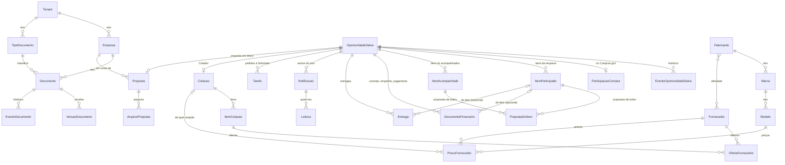

# Domínio

Extraído do protótipo (branches `claude/siga-pregao-tool-6o8zbs` /
`claude/tenta-de-novo-xu2sxb`), que validou o domínio contra as APIs reais do
PNCP e do compras.gov.br. Esta é a base para os models Django — os nomes de
campo do protótipo (SQLAlchemy/SQLite) estão mantidos como referência, com o
que muda para uma stack multiusuário sinalizado.

## Entidades

### Mapa das tabelas principais

Desenhado a partir dos `models.py` de `licitacoes`, `cotador`,
`fornecedores`, `produtos`, `propostas`, `empresas`, `documentos`,
`notificacoes`, `sentinela` e `tenants` (11/11/2026). Ficam de fora os campos
e os "quem fez" (`criado_por`, `salva_por`…, todos ligados a `User`).

Observações tiradas do código:

- `PropostaDoItem` é de **um** item: ou `ItemParticipado` (a empresa
  disputa) ou `ItemAcompanhado` (ele só acompanha).
- `OfertaFornecedor` aponta também para `Fabricante`, `Marca` e `Modelo`
  (opcionais; omitido no desenho para não poluir).
- `MercadoDoItem` não se liga a nenhuma tabela: a chave é a descrição
  normalizada do item (ver `mercado.py`).
- Só `Empresa`, `Documento`, `TipoDocumento`, `ModeloProposta`,
  `ArquivoProposta` e a configuração de armazenamento têm `tenant`.
  `OportunidadeSalva`, `Cotacao`, `Fornecedor` e os produtos **não têm**
  (hoje há um tenant só). Eles ganham a coluna no dia do segundo cliente
  (ver "`Tenant` e `Empresa`" abaixo).

### `Pdm` — Padrão Descritivo de Material
Índice local do catálogo oficial de materiais do compras.gov.br. A API não
tem busca textual utilizável sobre o catálogo, então o catálogo inteiro
(~20 mil registros, 41 páginas de 500) é baixado e indexado localmente para
permitir busca por nome de produto.

| Campo | Tipo | Observação |
|---|---|---|
| `codigo_pdm` | int (PK) | código do produto no catálogo oficial |
| `nome_pdm` | string | nome como veio da API |
| `nome_normalizado` | string, indexado (trigram) | caixa alta, sem acento — busca por produto (camada 1) |
| `codigo_classe`, `nome_classe` | int / string, opcionais | |
| `nome_classe_normalizado` | string, indexado (trigram), opcional | busca por categoria (camada 2) |
| `codigo_grupo`, `nome_grupo` | int / string, opcionais | |
| `nome_grupo_normalizado` | string, indexado (trigram), opcional | busca por categoria (camada 2) |
| `atualizado_em` | datetime | |

Tabela única, denormalizada de propósito — sem `Grupo`/`Grupo` como tabelas à
parte. Em ~20 mil linhas, um JOIN não compensa o ganho de normalização, e a
busca interativa fica mais rápida lendo uma tabela só. Ver "Busca textual —
camadas" abaixo para o motivo dos três índices trigram.

Alimentado por uma task periódica (`sincronizar_catalogo_pdm`, Celery Beat),
não por escrita de usuário — e por um `management command` equivalente
(`sincronizar_catalogo`) para rodar fora do agendamento.

### Busca não guarda licitação

A busca de oportunidades é **consulta ao vivo** no PNCP e no Compras.gov.br
(`PncpClient`/`ComprasGovClient`), cruzada com `Pdm` quando há
palavra-chave. Nada é guardado até alguém **salvar** — aí vira
`OportunidadeSalva` (abaixo). Ver "Busca de oportunidades".

### `Tenant` e `Empresa`

**`Tenant`** é a operação de licitação dona dos registros. Hoje existe uma
linha só — Inside Solutions, criada pela migração inicial de `apps/tenants` —
e não há tela para cadastrar outra: o produto se comporta como se fosse de um
cliente só, porque é. O model existe porque a coluna que falta é cara de
acrescentar depois: uma FK que nasce nula em milhares de linhas já gravadas
não tem como ser preenchida. Quem nasce daqui para frente já nasce com ela;
`Fornecedor`, `OportunidadeSalva` e `Cotacao` ganham a sua no dia do segundo
cliente, e aí a migração é trivial porque só há um tenant para apontar.

**Tenant não é empresa.** Um cliente tem *várias* empresas — matriz, filial,
a que cobre outro CNAE — e escolhe com qual delas disputa cada licitação. A
relação é um-para-muitos e o caminho de volta faz parte do model:
`tenant.empresas` e `tenant.empresa_padrao`. Toda FK de tenant no projeto sai
de `tenant_campo(related_name)`, que exige o nome da volta justamente para
que nenhuma nasça com `related_name="+"` — vínculo que existe só no banco não
existe no Django.

`apps/tenants/atual.py` é **o único lugar** que responde "de quem é esta
requisição". Todo o resto chama `tenant_atual(request)` — é o que torna a
virada multiempresa uma mudança de uma função, e não uma varredura por todo
filtro de queryset já escrito.

**`Empresa`** são os CNPJs com que a equipe **disputa** — não confundir com
`Fornecedor`, que é de quem a equipe compra para revender. São perguntas
diferentes: do fornecedor importam preço, prazo e condição de pagamento; da
empresa importa habilitação. Implementado em `apps/empresas/models.py`.

- **Mais de um CNPJ é comum em licitação.** Matriz e filial disputam lotes
  diferentes, e uma segunda empresa cobre CNAE que a primeira não tem. Quem
  monta a proposta escolhe qual usar; com um CNPJ só, o seletor não aparece.
- **Uma empresa é a padrão**, por tenant — garantido por índice parcial no
  banco, além do `save()` que desmarca a anterior. A primeira empresa
  cadastrada nasce padrão: cadastro com uma empresa só e nenhuma escolhida
  abriria proposta sem CNPJ.
- **`porte` não é papelada.** ME e EPP têm empate ficto e prazo para
  regularizar certidão fiscal depois de vencer a disputa (LC 123) — é o campo
  que mais muda o que acontece no pregão. É ele que substitui a "categoria"
  do fornecedor, que aqui não faz sentido.
- **Não existe excluir**, ao contrário do fornecedor: a empresa está amarrada
  a propostas e processos, então o que existe é inativar (`ativa = False`) —
  some do seletor de CNPJ, continua no histórico. Mesma disciplina da remoção
  lógica da oportunidade salva. A empresa padrão não pode ser inativada sem
  que outra assuma o lugar.
- **Unicidade de CNPJ é por tenant**, e não global como no fornecedor: dois
  clientes do produto podem cadastrar o mesmo CNPJ de uma sociedade que
  compartilham, e um não pode impedir o outro.

### Documentos da empresa — `TipoDocumento`, `Documento`, `VersaoDocumento`

A pergunta que este módulo responde não é "onde estão meus arquivos", é
**"estou habilitado hoje?"**. Em pregão a habilitação só é cobrada de quem já
venceu, com prazo de horas para enviar tudo, e o CRF do FGTS vale 30 dias —
doze vencimentos por ano em um documento só. Implementado em
`apps/documentos/models.py`.

- **`TipoDocumento` é o catálogo.** A lista é fixa porque a Lei 14.133
  organiza a habilitação em quatro blocos (jurídica; fiscal, social e
  trabalhista; econômico-financeira; técnica) e são sempre os mesmos
  documentos — o que muda é a data. Vem semeado por migração; `tenant` nulo é
  o catálogo padrão e preenchido é o que aquele cliente acrescentou, porque o
  edital que pede um alvará específico não pode exigir deploy.
- **`Documento` é a vaga** daquele tipo naquela empresa: não guarda arquivo
  nem validade, guarda qual versão está valendo. É a linha da tabela.
- **`VersaoDocumento` é o arquivo**, com o número, a emissão e a validade
  *daquela emissão*. Renovar não corrige uma data: cria outra certidão, que é
  outra versão da mesma vaga. Imutável depois de gravada — é isso que permite
  provar depois o que foi entregue num processo.
- **A situação é calculada, nunca gravada**: `pendente` (sem versão),
  `valido`, `a_vencer` (≤ 30 dias), `vencido` (validade < hoje) e
  `arquivado`. Campo gravado envelhece sozinho, que foi exatamente o que
  aconteceu com `Fornecedor.situacao`. Tipo que não vence (contrato social,
  atestado) nunca entra na conta de vencidos.
- **Empresa nova nasce com as vagas abertas** (signal em
  `apps/documentos/signals.py`): uma tela em branco não diz o que falta, e
  "nove pendentes" diz.
- **Nada some.** `DELETE` arquiva; a versão anterior continua no histórico; o
  arquivo mora no bucket do tenant (`apps/armazenamento`) e o download é
  sempre por URL assinada de curta duração — certidão tem CNPJ, endereço e
  nome de sócio.
- **`EventoDocumento`** registra enviou, renovou, baixou, arquivou —
  mesmo padrão do `EventoOportunidadeSalva`.

Não confundir com os documentos da **licitação** (edital, proposta do
fornecedor, empenho): lá não há lista fixa nem validade, e o mesmo processo
tem três catálogos e nenhum atestado. Os dois só compartilham o
armazenamento — ver
[`Tarefas/feat-documentos-processo.md`](Tarefas/feat-documentos-processo.md).

### `OportunidadeSalva`

Uma compra (edital) que alguém escolheu guardar para trabalhar depois — o
que o botão "Salvar oportunidade" do card grava. A busca continua sem
persistir nada; salvar é o único momento em que uma oportunidade vira
registro. Implementado em `apps/licitacoes/models.py`.

Duas decisões de produto moldam o model:

- **A lista é da empresa, não do usuário** (29/08/2026). Quem salvou fica
  registrado (`salva_por`), mas a oportunidade aparece para todos os
  usuários: o time trabalha a mesma lista. Não há filtro por dono em
  nenhuma consulta, e a unicidade é global — a mesma compra não entra duas
  vezes.
- **Excluir da lista não apaga o histórico.** O log precisa poder dizer "foi
  removida por fulano" *depois* da remoção, então excluir é remoção lógica
  (`removida_em`/`removida_por`). A unicidade vale só entre as ativas
  (`UniqueConstraint` com `condition=removida_em IS NULL`), o que permite
  salvar de novo depois — criando um registro novo, com log próprio, sem
  misturar com a história do anterior.

| Campo | Tipo | Observação |
|---|---|---|
| `cnpj_orgao`, `ano_compra`, `sequencial_compra` | string | identidade da compra no PNCP; a propriedade `chave` (`cnpj-ano-sequencial`) é a mesma que o card usa no frontend |
| `objeto`, `orgao_nome`, `uasg`, `uf`, `municipio`, `modalidade`, `situacao` | string | snapshot de exibição (a lista renderiza sem rechamar API) |
| `data_publicacao`, `data_encerramento_proposta` | date, nullable | a segunda é a base do status "expirada" |
| `valor_total_estimado` | decimal, nullable | soma dos itens; nulo se algum item não tiver valor (não soma parcial) |
| `plataforma_id`, `plataforma_nome`, `link_plataforma`, `link_pncp` | string | como estavam no momento do salvamento |
| `capag` | JSON, nullable | selo como estava ao salvar |
| `itens` | JSON | **snapshot** das linhas da busca daquele edital (formato de `OportunidadeSerializer`) — é com ele que o modal desenha o card sem ir na origem |
| `texto_busca` | text | objeto + descrição dos itens, normalizado; é o que a busca da tabela varre (sem índice: a consulta é substring, que btree não serve — se a lista crescer, copiar o `GinIndex`/`gin_trgm_ops` do `Pdm`) |
| `salva_por` | FK `User`, nullable | quem salvou (informação, não filtro) |
| `criada_em` | datetime | |
| `removida_em`, `removida_por` | datetime / FK `User`, nullable | remoção lógica |

Regras:

- **Status "expirada" é calculado, não gravado**: `data_encerramento_proposta
  < hoje` (nula = não expira). Nada de task pra marcar expirada. O que se
  grava é o *evento* de que o prazo venceu — uma vez só, ver o log abaixo.
- **Salvar é por edital/compra** (o card), não por item.
- **Salvar é só de ida.** O botão do card pede confirmação e não volta a ser
  um toggle: quem salvou tira a oportunidade pelo módulo de salvas. Sem
  isso, um clique repetido viraria log de cria/apaga/cria — e o histórico
  perderia o sentido. Salvar a mesma compra de novo é idempotente (devolve o
  registro existente, sem novo evento).
- **Prazo vencido sai da lista de Salvas.** Salvas mostra só o que ainda
  está no prazo (`OportunidadeSalvaQuerySet.no_prazo`). Vencida, a
  licitação segue a regra da Torre de Controle: vai para **Descartadas**,
  ou fica em Cadastro de proposta esperando a Sentinela confirmar, se tiver
  cotação e for do Compras.gov.br (ver [`TORRE.md`](TORRE.md), seção 2). O card (na busca e no modal) continua dizendo em
  texto que o prazo encerrou e que não é mais possível gerar proposta —
  `expirada` é o que bloqueia a ação.
- **Dados voláteis não vêm do snapshot**: documentos do edital, plataforma
  de origem e selo CAPAG são consultados ao abrir o modal, em
  `CompraDetalheView` (cacheado, ver `services.detalhar_compra_cacheada`).
  O snapshot é o que permite abrir sem esperar rede; a consulta é o que
  mantém atualizado o que muda.

Endpoints (`apps/licitacoes/urls.py`, todos `IsAuthenticated`):

| Rota | O quê |
|---|---|
| `GET /api/licitacoes/salvas/` | lista paginada (`page`, `page_size`) **só das que estão no prazo**, com `busca` (objeto + itens) e `ordering` por nome de coluna da tabela |
| `POST /api/licitacoes/salvas/` | payload = `itens` (o resultado da busca daquele edital) + `capag` + `plataforma`; o resumo é derivado no backend. Repetido = 200 com o registro existente |
| `DELETE /api/licitacoes/salvas/<id>/` | tira da lista (remoção lógica) |
| `GET /api/licitacoes/salvas/chaves/` | só as chaves das ativas — é como a busca sabe que um card já está salvo |
| `GET /api/licitacoes/salvas/<id>/eventos/` | o histórico (ver abaixo) |
| `GET /api/licitacoes/salvas/<id>/processo/` | a história no formato do modal "Ver processo": etapa de cada evento e o desfecho — vale também para removidas |

Frontend: a busca é "Buscar oportunidades", no topo do menu; Salvas é a
etapa **Preparar › Oportunidade** da Torre. A tela de
salvas é uma tabela (`shared/ui/data-table`) com busca, ordenação por
qualquer coluna e paginação — todas integradas ao endpoint, nunca em
memória. Vencidas não aparecem (estão em Descartadas).

Colunas: **UASG, objeto (cortado em duas linhas, desde 08/11/2026),
modalidade, cidade, publicação, prazo da proposta e valor estimado**, mais
um menu de ações por linha (visualizar/excluir); clicar na linha abre a
visualização. Antes de 08/11/2026 o objeto **não** era coluna — é longo demais e empurrava a tabela para fora
da tela; ele continua sendo o que a busca varre, aparece como dica (`title`)
na coluna de UASG e inteiro no modal. Pela mesma razão a cidade é cortada
com reticências (a UF nunca some) e as ações ficam num menu em vez de
botões soltos: a tabela tem que caber num monitor médio sem rolagem
horizontal — no celular ela vira uma lista de cartões rótulo/valor.

### Histórico da oportunidade salva (`EventoOportunidadeSalva`)

Toda oportunidade salva carrega um log detalhado. O **módulo que exibe esse
histórico ainda não existe** — o que existe é o banco, o endpoint e a
disciplina de escrever a história desde já (história não se reconstrói
depois). A tela prevista: um registro principal ("a oportunidade X, com a
descrição Y, foi salva dia tal por fulano") com um link "detalhes" que abre
a lista do que aconteceu, no estilo de um extrato de ligação.

| Campo | Tipo | Observação |
|---|---|---|
| `oportunidade` | FK `OportunidadeSalva` | sobrevive à remoção da lista (que é lógica) |
| `tipo` | choices | ver tabela abaixo |
| `descricao` | text | texto pronto para exibição ("Removida da lista por Gustavo.") |
| `autor` | FK `User`, nullable | nulo = evento do sistema |
| `dados` | JSON | espaço livre por tipo — é daqui que sai o link de "abrir a proposta" quando esse módulo existir (`{"proposta_id": 42}`), sem migração nova |
| `ocorrido_em` | datetime | ordem do extrato |

| `tipo` | Quando entra |
|---|---|
| `salva` | no `POST` — abre o histórico |
| `prazo_vencido` | quando a lista é servida e a oportunidade já passou do prazo sem ter esse evento (idempotente). Não há task periódica: o status é calculado, e a linha do log só precisa existir antes de alguém abrir o histórico |
| `removida` | na exclusão (individual ou em lote pelas vencidas) |
| `proposta_gerada` | **ainda não produzido** — declarado porque o log já é escrito no formato final; entra junto com o módulo de propostas |

### Torre de Controle — etapas e saída do quadro

**Tudo sobre isso está em [`TORRE.md`](TORRE.md)**: os 4 estágios e as 14
etapas, a regra de cada uma (por item), de onde vem cada fato, Encerradas ×
Descartadas, registro de preços, sincronias e API.

Resumo para quem está só passando:

- **A etapa é calculada, nunca gravada** (`apps/licitacoes/torre.py`).
  Ninguém escolhe etapa nem arrasta cartão.
- **A etapa é do item**; o cartão fica na etapa do item mais adiante.
- **Cotar não é participar.** Encerradas = participou e saiu; Descartadas =
  saiu antes de participar. Uma licitação nunca está em dois lugares
  (`encerradas.py` + `test_saidas.py`).
- O quadro antigo (`ciclo.py`, `GET ciclo/`, colunas Oportunidade, Cotação,
  Proposta, Disputa, Empenho) foi substituído pela Torre em 08/11/2026. O
  código ainda está no repositório, sem tela, até `feat-remover-legado`.

Telas de saída: **Encerradas** e **Encerradas › Descartadas** — filtros
Período (últimos 90 dias, um dos últimos 12 meses, ou datas livres), Motivo,
UASG (parte do código basta) e UF; colunas UASG, cidade, data, motivo, onde
estava, valor cotado e estimado.

| Rota | O quê |
|---|---|
| `GET /api/licitacoes/torre/` | o quadro da Torre, com a etapa já calculada |
| `GET /api/licitacoes/descartadas/` | `data_inicial`/`data_final`, `motivo`, `uasg`, `uf`, `busca`, `ordering` |
| `GET /api/licitacoes/encerradas/` | mesmos filtros |

### `Cotacao` — a formação de preço de um edital

O que o **Cotador** grava. Porta para o app a planilha "Lucro Sobre Custo"
que a equipe usava no Excel: quanto pagar ao fornecedor, quais percentuais
incidem, por quanto disputar e até onde dá pra baixar num pregão.
Implementado em `apps/licitacoes/models.py` (fórmulas em
`apps/licitacoes/cotacao.py`).

Três decisões moldam o model:

- **Um-para-um com a oportunidade salva** (29/08/2026). A pergunta que o
  Cotador responde é "por quanto eu disputo *este* edital", então a cotação
  não existe solta: nasce presa a uma `OportunidadeSalva` e salvar de novo
  sobrescreve. Comparar cenários do mesmo edital exigiria `ForeignKey` mais
  nome/versão por cenário — não existe hoje.
- **Grava-se a entrada, não a tela.** `parametros` e `itens` guardam o que
  foi digitado; preço final, preço mínimo, equilíbrio e os degraus do
  simulador são derivados e recalculados na abertura. Gravar derivado
  congelaria números que mudam quando a alíquota muda.
- **Os totais são recalculados no servidor.** Ficam materializados
  (`valor_total`, `lucro_total`) porque a listagem precisa deles sem
  reprocessar item a item, mas total vindo do cliente é ignorado: o `save()`
  refaz a conta. Caso contrário uma requisição adulterada gravaria um lucro
  que não corresponde aos itens ao lado dele.

| Campo | Tipo | Observação |
|---|---|---|
| `oportunidade` | OneToOne `OportunidadeSalva` | `on_delete=CASCADE` — tirar o edital leva a cotação junto |
| `parametros` | JSON | percentuais como **fração** (0,08 = 8%); JSON e não colunas porque a lista de tributos muda com o regime tributário |
| `itens` | JSON | um por item cotado, na ordem da tela, incluindo o `lance` corrente |
| `valor_total`, `lucro_total` | decimal | recalculados no `save()`, somente-leitura na API |
| `atualizada_por` | FK `User`, nullable | |
| `criada_em`, `atualizada_em` | datetime | |

Regras da conta (as mesmas da planilha de origem):

- **Duas bases de percentual.** Transporte, garantia e lucro incidem sobre o
  **custo** (o valor pago ao fornecedor): "35% de lucro" é ganhar 35% sobre
  o que o produto custou. Os tributos (ICMS/Simples, PIS, COFINS, IPI, ISS)
  incidem sobre a **venda**. Por isso o preço não é custo + margem, e sim
  `(custo + produto × lucro) / (1 − impostos)` — a divisão embute o imposto
  que ainda vai cair sobre o próprio preço.
- **Três preços de referência por item**: o *final* (com o lucro desejado),
  o *mínimo* (com o lucro mínimo) e o de *equilíbrio* (lucro zero — cobre
  custo e imposto e nada mais).
- **Tributo somando 100% ou mais da venda devolve zero**, não infinito — é o
  `IFERROR` da planilha; propagar infinito envenenaria todos os totais.
- A conta existe **duas vezes**, no frontend (`cotador.model.ts`, que
  recalcula a cada tecla) e no backend (`cotacao.py`, que grava). As duas
  são ancoradas no mesmo exemplo documentado na planilha (R$100 + 8% + 10% +
  35% = R$158,89, lucro líquido R$35), então divergência entre elas quebra
  um teste dos dois lados.

### `Fornecedor`, produtos e preços

Implementado em `apps/fornecedores` e `apps/produtos` — as docstrings dos
`models.py` têm o detalhe; aqui vai o que molda o produto.

- **Fornecedor é de quem a equipe compra** para revender; **Empresa** é com
  que CNPJ ela disputa. São cadastros diferentes de propósito.
- **A lista é da empresa, não do usuário**, e o CNPJ do fornecedor é único
  no cadastro inteiro.
- **Situação é dado do cadastro**: "Documentação vencida" e "Inativo" ficam
  no cadastro e nas cotações antigas, mas não são oferecidos em cotação nova.
- **Produto é o modelo:** Fabricante › Marca › Modelo, sem duplicar (nome
  comparado sem acento e sem caixa). A mesma marca em outro fabricante é
  outro produto.
- **Afinidade é por fabricante:** quem vende um fabricante vende todas as
  marcas e modelos dele. O Cotador sugere primeiro os fabricantes do
  fornecedor escolhido, e **aprende** ao salvar: grava a afinidade e o custo
  em `PrecoFornecedor` (histórico — a sugestão é a linha mais recente).

Ainda não está aqui: registrar o preço que o fornecedor passou **sem**
cotação (por embalagem, ex.: "caixa com 10 a R$ 34") e a busca "onde tenho
preço de caneta?". Foi feito no repositório original (`VastiMV/licita`,
branch `claude/precos-fornecedor`) e ainda não trazido para este.

### `Proposta`

Implementado em `apps/propostas`. O botão "Gerar proposta" do Cotador cria
o registro. **Não muda a etapa** da Torre: o PDF é a proposta ajustada,
pedida depois de ganhar (regra de 07/11/2026, ver [`TORRE.md`](TORRE.md)). Uma por oportunidade;
o valor é gravado ao gerar (mexer na cotação depois não muda o proposto). A
tela é o lugar de tudo o que sobe na plataforma: a proposta comercial em
Word (a partir do modelo do cliente), os documentos de habilitação da
empresa e os arquivos da licitação.

## Regras de negócio confirmadas contra as APIs reais

Custou várias sessões para validar — tratar como restrição de design, não
reabrir a investigação:

- **`compras.gov.br` não tem busca textual sobre o catálogo.**
  `descricaoItem` devolve zero resultados para qualquer termo, mesmo exato.
  Todo o mecanismo do `Pdm` existe para contornar isso.
- **Paginação da API é limitada a 10–500 itens por página**
  (`tamanhoPagina`); fora da faixa, HTTP 400.
- **O PNCP tem busca textual não documentada**, usada pela tela
  `pncp.gov.br/app/editais`: `GET /api/search/?q=...&tipos_documento=edital&status=...`.
  Essa é a via preferida para casar palavra-chave com o **objeto do edital**;
  o catálogo de `Pdm` é o *fallback* quando o PNCP não responde ou não acha
  nada.
- **Precisa de rede real para testar** — ambientes de sandbox costumam
  bloquear `pncp.gov.br` e `dadosabertos.compras.gov.br` na camada de proxy.

### Busca de oportunidades (fluxo, não persiste)

A tela pede **um alvo de busca só**: um rádio escolhe entre *palavra-chave* e
*UASG*, e o campo de texto vira um ou outro (decisão de produto, 06/09/2026).
Não é preferência de layout: combinar os dois nunca funcionou, porque a busca
textual do PNCP não aceita filtro de unidade — a UASG era aplicada *depois*,
sobre a página de 50 editais que o PNCP devolveu, e quase sempre zerava o
resultado sem explicar por quê.

1. Usuário escolhe o modo e informa o termo (palavra-chave OU UASG), UF,
   modalidade e período.
2. Modo UASG (ou campo vazio): modo navegação — lista as contratações do
   período pela unidade/modalidade, sem depender da busca textual nem de
   `Pdm` (os *itens*, esses sim, vêm do PNCP — ver o achado de 06/09/2026
   abaixo).
3. Com palavra-chave: tenta casar no objeto do edital via busca textual do
   PNCP.
4. Se o PNCP não responde ou não acha nada, cai para a busca em `Pdm` (ver
   "Busca textual — camadas" abaixo) — a palavra vira um ou mais
   `codigo_pdm`, que filtram a chamada ao compras.gov.br.
5. Resultado é por **item da contratação** (não a contratação inteira):
   número do item, descrição, quantidade, valor unitário/total estimado,
   link para abrir a compra **na plataforma** (garantido em todo resultado —
   ver a decisão de produto de 28/08/2026 abaixo: só entra oportunidade da
   plataforma escolhida, com link de disputa) e o edital no PNCP.
   **No card, os itens vêm recolhidos** (11/11/2026, GEN-30): aparecem os
   **3 primeiros** e o botão "Ver todos os N itens" ("Mostrar menos" volta).
   O total do rodapé soma todos. Por quê: licitação com muitos itens
   obrigava a rolar a tela até o próximo card. Só na busca — o modal da
   oportunidade salva mostra todos (`recolherItens` no `edital-card`).

### Busca textual — camadas

Decisão de arquitetura (25/08/2026): a busca por palavra-chave é
**determinística, em camadas — nunca um agente de IA decidindo livremente**.
Um agente com uma tool de busca no banco pode inventar/citar um código de
PDM que não existe, é não-determinístico (quebra o padrão de testes sem rede
já estabelecido — ver "Estratégia de testes" em `docs/ARQUITETURA.md`), e
adiciona latência/custo por busca numa tela que responde ao vivo. Nenhuma das
camadas abaixo gera texto livre: todas apenas ranqueiam linhas que já existem
de verdade no catálogo.

1. **Busca textual do PNCP** — objeto do edital, ver acima. Cobre material e
   serviço, mas depende de um endpoint não documentado (ver "Precisa de rede
   real para testar" acima e o histórico de instabilidade nos branches do
   protótipo).
2. **Catálogo local (`Pdm`), por similaridade** — quando o PNCP falha ou não
   acha nada. Dois casos, cobertos pelos três índices trigram (`pg_trgm`) do
   model:
   - **Erro de digitação / variação** ("cafe" vs "café" vs "cafezinho"):
     casa contra `nome_normalizado` (nome do produto).
   - **Categoria, não produto** ("material de escritório" quando o catálogo
     tem "CAFÉ", "PAPEL A4" etc. como PDMs individuais, agrupados sob uma
     classe/grupo do próprio governo): casa contra `nome_classe_normalizado`/
     `nome_grupo_normalizado`. Aproveita a categorização que a API já
     entrega — sem manter um dicionário de sinônimos próprio (trabalho que
     cabe a quem já cataloga isso oficialmente, não a este sistema).
   Só cobre material — catálogo de serviço tem estrutura própria, não
   integrada.
3. **Busca semântica por embedding — fora do escopo da primeira versão.**
   Fecha o caso que trigram não cobre: termo sem raiz textual em comum com o
   nome do produto/categoria (ex.: "bebida quente de escritório" → "café").
   Desenho já decidido, implementação futura:
   - O modelo de embedding roda num **pod separado** (não no backend/worker
     Django) — isola o consumo de memória do peso do modelo e permite
     escalar/trocar o modelo sem tocar no resto. Candidato a fine-tuning
     posterior para o vocabulário de licitação em português.
   - O vetor de cada `Pdm` é calculado **uma vez, no sync do catálogo**
     (task assíncrona), não por busca — a busca interativa só embeda o termo
     do usuário (uma chamada rápida ao pod) e faz *nearest neighbor* contra
     vetores já salvos.
   - Exige a extensão `pgvector` no Postgres (não instalada ainda — checar
     antes de implementar) e uma coluna de vetor em `Pdm`.
   - Como as camadas 1+2 já resolvem a maior parte dos casos reais, essa
     camada só entra se o uso mostrar que ainda sobra volume relevante de
     buscas por categoria/sinônimo que trigram não pega.

## Integrações externas (async, via Celery)

| Integração | Uso |
|---|---|
| `compras.gov.br` (`dadosabertos.compras.gov.br`) | catálogo de materiais (PDM), contratações/itens |
| PNCP (`pncp.gov.br/api/...`) | busca textual de editais, itens/documentos/detalhe da contratação |
| Tesouro Transparente (`tesourotransparente.gov.br/ckan/...`) | notas CAPAG (município/estado) — `apps/capag` |
| Dados Abertos do Compras.gov (resultados e atas por `niFornecedor`) | o que a empresa ganhou e as atas de registro de preços — sincronia diária às 8h (`sincronia_pncp.py`), ver [`TORRE.md`](TORRE.md) |
| Portal da Transparência (`api.portaldatransparencia.gov.br`, `despesas/documentos-por-favorecido`) | empenho, liquidação e pagamento federais — sincronia diária às 8h10 (`sincronia_transparencia.py`). Precisa da chave `PORTAL_TRANSPARENCIA_CHAVE` (header `chave-api-dados`) |
| Compras.gov.br na sessão do fornecedor | lido pela **Sentinela** (extensão do Chrome, 0.2.6), ver [`SENTINELA.md`](SENTINELA.md) |

O sync do catálogo (~41 páginas de 500 registros) roda **sequencial, com um
intervalo entre páginas** (`catalogo_sync_intervalo_segundos` em
`Environment`) — de propósito mais lento que o necessário, para não gerar uma
rajada de requisições numa API pública e gratuita do governo.

Validado contra o cluster real (26/08/2026): sync completo trouxe **20.419
PDMs**, batendo com a estimativa. A busca por categoria (camada 2) também
confirmada com dado real — "material de escritório" (que não é nome de
nenhum PDM) achou os produtos certos via `nome_grupo`/`nome_classe`. Dois
achados novos:

- **O mirror `dadosabertos.compras.gov.br` tem defasagem de ~1 mês** em
  relação ao PNCP — uma janela de 30 dias no modo navegação veio vazia; 90
  dias trouxe resultado normal. Não é bug, é característica do mirror —
  o default de janela do modo navegação deve considerar isso.
- **A busca textual via PNCP era lenta para termo genérico** (~2min para
  "cafe", que casava ~50 editais e disparava uma chamada de itens por
  edital, em rodadas de 8 por vez). Corrigido em 26/08/2026 (relatado como
  bug pelo usuário): `MAX_EDITAIS_PNCP` 50 → 20 e `MAX_WORKERS` 8 → 20
  (`apps/licitacoes/services.py`) — mesma chamada, menos editais
  inspecionados e quase tudo numa rodada só de paralelismo em vez de ~7.
- **Este ambiente de sandbox alcançou `pncp.gov.br` e
  `dadosabertos.compras.gov.br` normalmente** (diferente do bloqueio
  relatado nas sessões do protótipo) — pode variar por sessão/ambiente,
  não tratar como garantido.
- **Achado crítico, 26/08/2026: o filtro `codigoModalidade` do
  compras.gov.br usa uma tabela de códigos diferente da tabela oficial do
  PNCP** que o protótipo documentou (`MODALIDADES` em
  `apps/integracoes/clients/compras_gov.py`). Nessa tabela do PNCP, "6" é
  Pregão Eletrônico; no filtro do compras.gov.br, "6" é **Dispensa** — e
  Dispensa não tem sessão de disputa ao vivo no Comprasnet, então o link
  "abrir no compras.gov.br" sempre dava 404 pra quem caía nesse default
  errado. Varridos os 13 códigos da tabela do PNCP contra um ano inteiro de
  dados reais: só 4 devolvem registro (`MODALIDADES_CONTRATACOES`, no mesmo
  módulo) — os outros 9 são aceitos pela API sem erro, mas nunca trazem
  nada. Corrigido o default do modo navegação (era "6", virou "5") e o
  dropdown do frontend. **Confirmado em 26/08/2026**: a busca textual do
  PNCP (`/api/search/`, parâmetro `modalidades`) usa a tabela "oficial" do
  PNCP (`MODALIDADES`), não a de `MODALIDADES_CONTRATACOES` — testado ao
  vivo variando o parâmetro e conferindo `modalidade_licitacao_nome` nos
  resultados ("5" só devolvia "Concorrência - Presencial", "6" só
  "Pregão - Eletrônico" etc.). Isso fazia o filtro de modalidade na busca
  por palavra filtrar pela modalidade errada sem erro nenhum — bug real
  relatado pelo usuário (selecionava uma modalidade específica e via
  resultado de outra). Corrigido com uma tabela de tradução,
  `MODALIDADE_CONTRATACOES_PARA_PNCP` em
  `apps/integracoes/clients/compras_gov.py`, aplicada em
  `apps/licitacoes/services.py::_buscar_no_pncp` antes de chamar o PNCP.
- **Achado, 26/08/2026: além de `/api/search/` (não documentado, usado pra
  busca textual) e `/api/pncp/v1/orgaos/...` (não documentado, usado pra
  itens), o PNCP tem uma terceira API, essa sim documentada:
  `/api/consulta/v1/orgaos/{cnpj}/compras/{ano}/{sequencial}`** (o
  `/api/pncp/v1/orgaos/.../compras/{ano}/{sequencial}` sem sufixo redireciona
  `301` pra ela). Devolve `orgaoEntidade.esferaId` (`F`/`E`/`M`) e
  `unidadeOrgao.codigoIbge` — usados por `apps/capag/lookup.py` pra casar a
  compra com a nota CAPAG do ente certo (município OU estado, nunca por nome
  de órgão: um órgão estadual pode ter nome de faculdade/fundação, sem
  "estado" em lugar nenhum — testado com a Faculdade de Medicina de São José
  do Rio Preto, `esferaId: "E"`, vinculada ao estado de SP apesar do nome).
  `/api/pncp/v1/orgaos/.../arquivos` (mesma família não documentada de
  `/itens`) devolve os documentos do edital com link de download direto —
  `200`, PDF de verdade, sem precisar do site do PNCP. `PncpClient
  .detalhar_compra`/`.listar_arquivos` (ver `apps/integracoes/clients/pncp.py`).
- **Achado crítico, 28/08/2026: o link "abrir no compras.gov.br" dava 404
  pra TODO resultado vindo da busca textual do PNCP — por dois motivos
  somados.** (1) O `idCompra` do Comprasnet tem **17 dígitos**: UASG(6) +
  **modalidade(2, na tabela do compras.gov.br)** + número(5) + ano(4) — a
  remontagem (`_montar_id_compra` em `clients/pncp.py`) omitia os 2 dígitos
  da modalidade (o comentário antigo dizia "confirmado contra a API", mas o
  formato estava errado; confirmado agora contra o `linkSistemaOrigem` real:
  `...compra=92553805900672026` = 925538+05+90067+2026). (2) Mais
  fundamental: **o PNCP é o agregador nacional — a busca textual devolve
  edital de QUALQUER plataforma** (Comprasnet, Portal de Compras Públicas,
  BLL, Licitanet, ...), e o link era montado como se tudo fosse Comprasnet;
  pra compra que não vive lá, 404 mesmo com o formato certo. A solução
  definitiva veio de graça: a API documentada de consulta
  (`/api/consulta/v1/orgaos/{cnpj}/compras/{ano}/{seq}`, que
  `CompraDetalheView` já chama pro CAPAG) devolve **`usuarioNome`** (o
  sistema que publicou, ex.: "Compras.gov.br") e **`linkSistemaOrigem`** (o
  deep link pronto pra plataforma de origem, seja ela qual for — confirmado
  ao vivo pros dois casos). Medição ao vivo (28/08/2026, termo "café",
  página de 50): **só 11 editais eram do Comprasnet**; 11 vieram sem
  `linkSistemaOrigem` nenhum; os outros 28 eram de 13 plataformas
  diferentes. E o campo `numero` da busca textual veio `None` em todas as
  amostras — link remontado a partir da busca não é confiável.
- **Decisão de produto (28/08/2026): toda oportunidade devolvida é da
  plataforma escolhida e tem `link_plataforma` garantido** — sem link de
  disputa não existe oportunidade, e o botão dourado do card aparece
  SEMPRE. Hoje a plataforma é fixa (compras.gov.br, a única registrada);
  quando houver mais de uma, vira um dropdown na tela de busca (igual ao de
  modalidade) que manda o `plataforma_id` do registro — o parâmetro já
  existe em `services.buscar_oportunidades`. Consequência no caminho da
  busca textual: como a resposta do `/api/search/` não diz a plataforma, a
  orquestração lê até 50 editais (`MAX_EDITAIS_BRUTOS`), **detalha cada um
  em paralelo** (`_apenas_da_plataforma` em `apps/licitacoes/services.py`)
  e descarta o que não é da plataforma escolhida, gravando o
  `linkSistemaOrigem` definitivo nos que ficam; se nenhum sobrar, cai na
  reserva de catálogo (que já é 100% compras.gov.br). Custo: até ~50
  chamadas de detalhe extra por busca, em rodadas de 20 — é o preço de não
  mostrar oportunidade que o usuário não consegue abrir.
- **Achado crítico, 06/09/2026: o mirror de _itens_ do compras.gov.br está
  ~6 semanas atrás do mirror de _contratações_ — e era isso que fazia a busca
  por UASG (e a navegação sem palavra-chave) voltar vazia.** Medido ao vivo:
  `1_consultarContratacoes_PNCP_14133` já listava contratações publicadas até
  02/09, mas `2.1_consultarItensContratacoes_PNCP_14133_Id` respondia
  `{"resultado": [], "totalRegistros": 0}` — **sem erro, HTTP 200** — para
  tudo publicado de 01/08 em diante; só de ~24/07 para trás vinham itens.
  Como o modo navegação só produzia oportunidade a partir de item, qualquer
  edital recente sumia. Corrigido em `services._itens_da_compra`: os itens
  passam a vir do PNCP (`/api/pncp/v1/orgaos/{cnpj}/compras/{ano}/{seq}/itens`,
  a mesma fonte que a busca textual já usava, sem defasagem), com o
  compras.gov.br como reserva para o período antigo e para quando o PNCP está
  fora do ar. A contratação normalizada do compras.gov.br já traz
  `cnpj_orgao`/`ano_compra`/`sequencial_compra`, então não custa chamada
  extra de descoberta. Contratação sem item em fonte nenhuma passou a virar
  card mesmo assim (dá pra abrir o edital e a disputa) em vez de sumir.
- **Achado, 06/09/2026: "Todas as modalidades" na busca por UASG escondia
  dispensa e inexigibilidade.** O modo navegação caía no default de Pregão
  Eletrônico quando o dropdown estava em "Todas" — e o `codigoModalidade` do
  compras.gov.br é obrigatório e aceita um código por chamada. Com UASG
  informada, "Todas" passou a varrer as quatro modalidades de
  `MODALIDADES_CONTRATACOES` em paralelo, intercalando os resultados (o teto
  de `MAX_CONTRATACOES` é global; concatenar deixaria a primeira modalidade
  consumir a cota). Exemplo real (UASG 154050, 30 dias): 4 pregões + 3
  dispensas — antes só os 4 pregões apareciam. Sem UASG o default continua
  Pregão Eletrônico: ali a varredura é do período inteiro e cada modalidade a
  mais multiplica as chamadas de itens.
- **Medição da discrepância "PNCP mostra N, a tela mostra 11" (06/09/2026),
  termo "cafe".** É pergunta recorrente do cliente; os números do funil:
  o índice do PNCP tem **1.219** editais *recebendo proposta* (**74.986** sem
  filtro de status — daí a ordem de grandeza de milhares que se vê no
  portal); a tela lê **1 página de 50** (`MAX_EDITAIS_BRUTOS`); desses 50, só
  **9 eram do Compras.gov.br** (22 vinham sem `linkSistemaOrigem` nenhum e o
  resto se espalhava por 23 outras plataformas); o período da tela e o teto
  de `MAX_EDITAIS_PNCP` (20) cortam o que sobrar. Ou seja: **não é bug de
  busca — é o filtro de plataforma somado à leitura de uma página só**.
  Buscar acento ou não dá o mesmo total (1.219 para "cafe" e para "café").
  Aumentar a cobertura é decisão de produto com custo conhecido: cada página
  extra do PNCP são +50 chamadas de detalhe (é o detalhe que revela a
  plataforma), e o `/api/consulta/` tem rate limit por IP.
- **Plataformas são plugáveis** (28/08/2026): o ponto de entrada é
  `apps/integracoes/plataformas.py` — plataforma nova = uma subclasse de
  `Plataforma` registrada em `PLATAFORMAS` (+ o client dela em `clients/`,
  se tiver API própria; + nome/favicon no mapa `PLATAFORMAS` de
  `edital-card.component.ts` e o PNG em `frontend/public/plataformas/`).
  O PNCP **não** entra no registro: é agregador, não plataforma — fica como
  camada transversal de busca.
- **O 5xx do PNCP costuma ser transitório** (28/08/2026): visto um 500 de
  "connection pool timeout" em `/api/consulta/v1/...` que funcionou na
  tentativa seguinte. `PncpClient` repete uma vez erro >= 500 (4xx continua
  sem repetição — é resposta, não falha).
- **O `/api/consulta/` do PNCP tem rate limit por IP** (429, medido ao vivo
  em 28/08/2026): a rajada de ~50 detalhes de uma busca textual consome a
  janela — a próxima chamada ao endpoint (o detalhe do card, ou outra
  busca em seguida) leva 429 por alguns minutos. Só a família
  `/api/consulta/` é limitada; `/api/pncp/v1/...` (itens, arquivos) e
  `/api/search/` seguem normais. Mitigações no código: (1) os insumos do
  CAPAG e o link de origem vão **embutidos no resultado da busca** — o selo
  do card não depende de segunda chamada (`views._resolver_capag`); (2) o
  detalhe é **cacheado** (`services.detalhar_compra_cacheada`, TTL 6h,
  LocMem por padrão — apontar `CACHES` pra Redis no cluster compartilha
  entre pods). Degradação sob 429 sustentado: a busca textual não consegue
  confirmar plataforma e cai na reserva de catálogo (100% compras.gov.br,
  links garantidos) — o usuário continua vendo resultado.
- **CAPAG (Capacidade de Pagamento) não é API — é arquivo estático do
  Tesouro Nacional**, atualizado ~3x/ano: XLSX de municípios
  (`tesourotransparente.gov.br/ckan/dataset/capag-municipios`, aba "Prévia
  da CAPAG", colunas `Código Município Completo` = código IBGE,
  `Nome_Município`, `UF`, `CAPAG` = nota) e CSV pequeno de estados
  (`.../capag-estados`, coluna `Classificação da CAPAG`). Nota final numa
  escala só, `A+ A B+ B C D` (`#N/A`/`n.d.`/`n.e.` = não avaliado, sem
  selo). URL do arquivo vigente sempre via `package_show` do CKAN (nunca
  hardcoda nome/data — muda a cada publicação). `apps/capag/sync.py` baixa
  e grava; agendado no Celery Beat, mensal (folga confortável pra uma fonte
  que só muda a cada ~4 meses).

## O que muda do protótipo para a stack de produção

- **Autenticação multiusuário** — API protegida (DRF + JWT).
- **Agendamento sai do processo da app** (`APScheduler` embutido) **e vira
  Celery Beat**, para sobreviver a réplicas efêmeras do pod da API.
- **SQLite → PostgreSQL**, com `raw_json` como `JSONField` nativo em vez de
  texto serializado.
- **Envio de e-mail e chamadas às APIs externas viram tasks Celery**
  assíncronas, nunca bloqueando o request HTTP.

## Decisões da operação (histórico)

Decisões de produto tomadas com a operação, em ordem. Quando uma regra
acima parecer estranha, a razão costuma estar aqui.

| Data | Decisão |
|---|---|
| 29/08/2026 | Lista de salvas e cadastros são da empresa, não do usuário |
| 06/11/2026 | Descartada (tirada da lista) sai de Encerradas — pedido do Carlinhos |
| 07/11/2026 | Descartadas ganha tela própria, abaixo de Encerradas |
| 07/11/2026 | **Cotar não é participar:** tudo que saiu do ciclo antes do certame (tirada da lista ou prazo vencido, com ou sem cotação) é Descartada; Encerradas é só quem participou |
| 07/11/2026 | Motivos em Descartadas em texto normal (sem vermelho); filtros por período/mês, motivo e UASG, numa linha só |
| 07/11/2026 | Logo novo da Inside Solutions, sobre faixa escura (`--color-marca-fundo`) |
| 07/11/2026 | **Sem Integra Compras (Serpro):** cobra por requisição, fora do orçamento. A leitura do Compras.gov será pela Sentinela, na sessão do próprio Carlinhos. **Nunca burlar captcha, nunca guardar senha gov.br** |
| 07/11/2026 | **Torre de Controle** substitui "Ciclo de Licitação": 4 estágios, 13 etapas definidas com o Carlinhos; a etapa é do item; o PDF da proposta não é etapa (é a proposta ajustada, depois de ganhar); Recurso e Suspensa são etiquetas |
| 07/11/2026 | Vitória homologada no PNCP que não estava salva no Licita é **criada** sozinha (nenhuma vitória fica de fora) |
| 07/11/2026 | Participou sem cadastrar proposta → Descartadas (`sem_proposta`). *Correção de 08/11/2026: o exemplo usado na época, o Cubatão (55/2026), tinha sim proposta — item 2, 23º lugar (HAR de 08/11)* |
| 07/11/2026 | Prazo vencido com cotação no Compras.gov.br não é descartado: espera a Sentinela confirmar ("confirmar com a Sentinela") |
| 08/11/2026 | Torre publicada direto em produção (sem ambiente de teste), à noite, fora de sessão. **A Torre é a tela inicial** |
| 08/11/2026 | Visual do protótipo "Licita v1.0": menu azul escuro com o número de cada etapa, Radar/Sentinela/sino no topo **mostrando o estado verdadeiro** (em breve / não instalada), letra Plus Jakarta Sans |
| 08/11/2026 | Ajustes da dona sobre o protótipo v2: cabeçalho atravessando a tela em cima, logo maior, **fundo branco** (sem o azulado), **cantos retos** (só pílulas e números redondos), Radar e Sentinela com cor viva (Sentinela âmbar enquanto não instalada), estágio aberto com as faixas encostadas no menu e no fim da janela, sem borda, e as 5 colunas de Disputar lado a lado |
| 08/11/2026 | Sincronias do PNCP e do Portal da Transparência só de **segunda a sexta** (fim de semana não tem movimentação) |
| 08/11/2026 | **Homologado passa para Contratar** (era a última etapa de Disputar) — pedido do Carlinhos: ganhou, agora é esperar contrato ou empenho. A ordem das 13 etapas não mudou |
| 08/11/2026 | **Lixeira** em todo cartão de Preparar e Disputar: uma pergunta (mostra o preço lançado), vai para **Descartadas** — que passa a aceitar quem participou quando é ele que descarta — com o motivo completo (quem, quando, etapa, preço). No Compras.gov só sai o favorito |
| 08/11/2026 | Descartada fica em silêncio; **convocação traz de volta, em vermelho**. Tudo que pede resposta (convocação, pedido de desconto, **recurso**, diligência) é vermelho |
| 08/11/2026 | **Recurso que ninguém viu** (56/2026, item 22, Brava Sul): a Sentinela passa a vigiar a fase recursal de cada item a cada 10 min |
| 08/11/2026 | Slogan no login: **"Do edital ao empenho, do empenho ao Pix."** / "Você disputa. O Licita vigia." |
| 08/11/2026 | **Login vale 12 horas** desde a entrada, mesmo com uso (`SESSAO_MAXIMA_HORAS`, claim `login_em` conferida em `RefreshView`); depois do login, abre a Torre |
| 08/11/2026 | Cada usuário sobe a **própria foto** (menu da conta → Trocar foto); reduzida a 256×256 no navegador e guardada no cadastro (`User.foto`) |
| 08/11/2026 | Listas de editais: **clicar em qualquer lugar da linha abre** (Salvas → card; Cotação → Cotador; Propostas → proposta; Encerradas/Descartadas → Ver processo; etapas da Torre → como o cartão). Salvas ganhou a coluna **Objeto**, cortada sem aumentar a linha |
| 08/11/2026 | Menu: seção **Relatórios** (em breve), entre as saídas e os Cadastros |
| 09/11/2026 | **Regra única** de onde está cada licitação (`torre.avaliar`): Torre, Encerradas, Descartadas e os números do menu saem dela (o menu dizia 3 descartadas e a lista 4) |
| 09/11/2026 | 👍 1º de verdade · 🟠 **só o próximo de verdade** (quem caiu na frente não conta) · 👎 o resto; **"1º já habilitado"** = item perdido; todos assim → Encerradas |
| 09/11/2026 | Compra **suspensa** ou **sem prazo definido** fica em Preparar com aviso, vigiando a data nova; nunca sai sozinha por prazo |
| 09/11/2026 | **Data alterada pelo órgão** atualiza o Licita (Sentinela + PNCP diário), com linha no histórico e aviso |
| 09/11/2026 | Em "Minhas participações", prazo vencido, sem cotação → **Encerradas · "Acompanhando o resultado"**, com relatório ("xeretar"); se aparecer proposta dele, volta para a Torre |
| 09/11/2026 | **Vigia até a ata do concorrente**: todo item em que ele deu preço segue vigiado 1x por dia (convocação, recurso), esteja onde estiver; termina com a ata assinada com outra empresa ou 180 dias depois da homologação. Convocação/recurso traz de volta em vermelho |
| 09/11/2026 | **Sino** (`apps/notificacoes`) e **aviso "fora dos favoritos no Compras.gov"** (nada sai sozinho; ele decide pela lixeira) |
| 09/11/2026 | Etapas renomeadas: **Aceita e habilitada** e **Habilitada (aguardando adjudicação)** (as chaves não mudaram) |
| 09/11/2026 | **Relatório da licitação**: vencedor, marca, modelo, valor e diferença, item a item; valores absurdos (> 5× ou < 1/5 da mediana) fora das contas |
| 10/11/2026 | **Relatórios › Mês a mês**: participou, ganhou, perdeu, faturamento, lucro (só com cotação); "perdeu por pouco" = até 5%, numa linha só |
| 10/11/2026 | **Mercado de cada item**: o "mesmo item" é o **item exato do catálogo (CATMAT)**, achado pela descrição do edital (120 kg ≠ 150 kg); o tipo (PDM) só como referência; menos de 3 compras = "poucos dados" |
| 10/11/2026 | **Caixa de mensagens** do Compras.gov no sino: a lista já traz o texto, nada é aberto nem marcado como lido |
| 10/11/2026 | **Telegram**: os avisos do sino no celular de Vasti e Carlinhos (robô do @BotFather, chave só no `.env`) |
| 10/11/2026 | Prazo vencido **com cotação** e **fora dos favoritos** → Descartadas ("Prazo venceu com cotação"), sem esperar a Sentinela (Geriatria 34/2026) |
| 10/11/2026 | Compra trazida pela Sentinela sem órgão ou sem itens é **completada pelo PNCP** (só o que está vazio); Salvar da busca com a compra já na lista completa os campos vazios e registra quem salvou (Dispensa 27/2026, ararinhas) |
| 10/11/2026 | Cartão em Cadastro de proposta **sem cotação** abre o visualizador ("Iniciar cotação") em vez do Compras.gov |
| 10/11/2026 | **Fornecedor sem CNPJ e sem e-mail**: só a razão social é obrigatória; CNPJ, quando digitado, é conferido e único (GEN-19). *Pedido de voltar a ser obrigatório: GEN-54* |
| 10/11/2026 | Título da cotação longo (objeto com mais de 255 caracteres) é **cortado**, não recusa a cotação |
| 10/11/2026 | Etapa nova **Aguardando sessão** (Disputar): preço lançado no Compras.gov e sessão fechada; com a data da sessão; sem cotação no Licita avança com aviso. 14 etapas |
| 10/11/2026 | Prazo vencido com cotação no Compras.gov **sem nenhuma participação** → Descartadas no dia seguinte, mesmo nos favoritos (Guarulhos 461/2026). Fim do "confirmar com a Sentinela" |
| 10/11/2026 | `AGENTS.md`: decisões só com confirmação; documentação no mesmo PR para toda mudança; código GEN no ramo e no PR |

