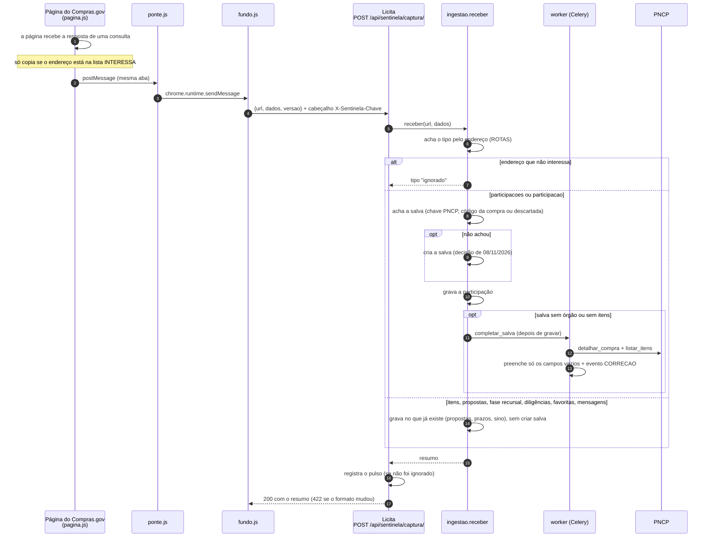

# Sentinela — plano e o que já existe (0.2.6, 12/11/2026)

A Sentinela é uma **extensão do Chrome** no computador do Carlinhos. Ela é a
ponte entre o Compras.gov.br (a sessão **dele**, já logada) e o Licita. Sem
ela, o estágio Disputar da Torre só anda quando o resultado sai no PNCP.

Este documento junta o que foi pesquisado e decidido (07–08/11/2026) para
quem for construir. **Todos os endereços do Compras.gov** (o que pede login,
o que abre direto, o que pede captcha): [`COMPRAS_GOV.md`](COMPRAS_GOV.md).

## O caminho de uma captura

Desenhado a partir de `sentinela/pagina.js`, `ponte.js`, `fundo.js` e, no
servidor, `apps/sentinela/views.py` (`CapturaView`) e `ingestao.py`.

Só as capturas de **participações** criam salva. A ronda (que consulta
sozinha) não lê participação, então **não cria nem completa** salva.

## O que já existe (beta 0.1)

Construída em 08/11/2026. Código da extensão em [`sentinela/`](https://github.com/VastiMV/licita-ec2/tree/main/sentinela)
(com o passo a passo de instalação); backend em `backend/apps/sentinela/`.

| Parte | Como funciona |
|---|---|
| **Participações e itens** | a extensão copia o que **a página já recebeu** quando o Carlinhos abre a tela (participações, uma compra, "meus itens", a proposta de um item) e manda ao Licita (`POST /api/sentinela/captura/`). O backend (`ingestao.py`) cria a compra se ela não estava no Licita e grava `ParticipacaoCompra` e `ItemParticipado` |
| **Camada de disputa** | painel no canto de qualquer tela de compra: teto, ideal, piso, custo e lucro de cada item, da cotação do Licita (`GET /api/sentinela/camada/<código>/`) |
| **Vigia** | sinal de vida a cada 3 min (`POST /api/sentinela/pulso/`); o topo do Licita lê `GET /api/sentinela/estado/` |
| **Autenticação** | a chave `SENTINELA_CHAVE` do servidor, no cabeçalho `X-Sentinela-Chave`. Nunca senha |

**Achados dos HARs que mudaram o plano:**

- **A lista de participações e a lista de itens pedem captcha** (o parâmetro
  `captcha` vai em cada consulta). Por isso a Sentinela **não consulta
  essas telas sozinha**: ela só repassa o que a página recebeu quando o
  Carlinhos abriu. Ler sozinha, de tempos em tempos, só o que não pede
  captcha (caixa de mensagens, a proposta de um item, a participação numa
  compra) — isso é a próxima etapa.
- **A lista "Todos os itens"** (o padrão ao abrir a compra, `filtro=1`)
  também traz a proposta da empresa dentro de cada item em que ela lançou
  preço. Desde 08/11/2026 a Sentinela aproveita as duas listas: basta abrir
  a compra, sem trocar o filtro.
- **Estar em "participações" não prova proposta.** Quem prova é a lista
  "meus itens". (O Cubatão, 55/2026, que achávamos estar sem proposta, tem
  proposta no item 2, em 23º lugar — HAR de 08/11/2026. Ninguém lembrava: é
  para isso que a Sentinela serve.) Quem prova é a lista "meus itens" (`filtro=2`): com item, há
  proposta; vazia, não há (→ Descartadas, "sem proposta cadastrada").
- **O pedido de desconto vem na proposta do item**
  (`situacaoUltimaNegociacao` + `justificativaUltimaNegociacao`, ex.:
  "Solicito um desconto para o Item 22"). Negociação em andamento vira
  alerta no cartão. Convocação de anexo (`situacaoUltimaSolicitacaoAnexos =
  S`) também.
- A sessão vive na **aba** do Compras.gov (token da página, não cookie):
  precisa de uma aba aberta e logada — uma só, não uma por licitação.

**Em uso desde 08/11/2026** no PC do Carlinhos (endereço do Licita **sem**
`www`: o `www.` redireciona e o Chrome troca o POST por GET → 405).

**Pedido em aberto (08/11/2026):** "desfavoritar" a compra no Compras.gov
quando ele descarta no Licita. Seria a **primeira escrita** da Sentinela no
Compras.gov — só com o clique dele, uma compra por vez, e só depois de um HAR
mostrando o endereço que o próprio Compras.gov usa. Ver "Onde paramos" em
`Tarefas/feat-torre-de-controle.md`.

**0.1.4 (08/11/2026) — posição e relatório:** a Sentinela lê sozinha a lista
de propostas de todos os participantes de cada item da empresa (sem captcha;
`ronda.py`). O Licita guarda em `PropostaDoItem` e mostra:

- **👍 / 🟠 / 👎** ao lado de cada item (lista da etapa) e "👍 ganhando 1 de 8"
  no cartão. 👍 = 1º **de verdade** (descontando quem caiu na frente:
  desclassificado ou inabilitado); 🟠 = o próximo a ser chamado (2º de
  verdade); 👎 = atrás disso, ou perdeu (`torre.sinal_do_item`).
- **Relatório da licitação** (botão "Relatório" na lista da etapa e "Ver
  relatório" em Encerradas): item a item, vencedor (ou 1º), marca, modelo,
  valor, a posição e o valor da Inside, a diferença em R$ e %, as marcas mais
  ofertadas e a lista inteira. Valor absurdo (mais de 5× ou menos de 1/5 da
  mediana) fica marcado e fora das contas (`relatorio.py`).
- Item **homologado** (o campo `homologado` da lista): se a vencedora não é a
  Inside, `vencedor_e_a_empresa = False` → item perdido; todos perdidos → a
  licitação vai para Encerradas. Compra com itens ganhos e perdidos fica na
  Torre (na etapa do item ganho), com os perdidos em 👎; o relatório mostra
  todos.

Ainda falta: confirmar o 🟠 com um caso real de "desclassificada" (os códigos
vêm do manual); o painel da camada mostrar só o item aberto (precisa do HAR
da tela de lances); relatórios gerais (seção Relatórios, com ECharts).

**0.2.1 (09/11/2026) — no ar:** lixeira (descartar no Licita tira o
favorito no Compras.gov), vigia de recurso e diligências, e o aviso **"fora
dos favoritos no Compras.gov"** nas compras de Preparar (a ronda pergunta ao
Compras.gov quais ainda estão nos favoritos; Lavras, 60/2027, é o caso que
motivou). Nada sai sozinho: ele decide pela lixeira.

**0.2.3 (09/11/2026):** primeira ronda 1 minuto depois que o Chrome abre;
a ronda inclui a **vigia diária** dos itens perdidos (na primeira ronda do
dia — se o computador ligar às 10h, é às 10h; o servidor anota o dia de cada
item, nenhum dia é pulado) e as compras que ele só acompanha. Regras em
[`TORRE.md`](TORRE.md), "Regras de 09/11/2026".

**0.2.4 (10/11/2026):** a ronda lê a **caixa de mensagens** do fornecedor
(`comprasnet-mensagem/v1/mensagens?size=20&page=0`). A lista já traz o texto:
nada é aberto, nada fica marcado como lido. Cada mensagem nova (até 3 dias)
vira aviso no sino e no Telegram; convocação (830) e recurso (850) em
vermelho.

**0.2.5 (11/11/2026):**
- **Painel do Cotador que dá para mover** (GEN-61): arraste pela faixa do
  topo; a posição fica guardada neste Chrome (`chrome.storage.local`,
  `camadaPosicao`) e o painel nunca sai da janela. O botão **–** minimiza:
  vira a etiqueta **"Cotador"**, mesma cor, que abre de novo com um clique
  (e também dá para arrastar). Fechar e minimizar são a mesma coisa (decisão
  da operação, 11/11/2026). **Por quê:** o painel ficava preso no canto
  inferior direito, em cima da tela do Compras.gov.
- **Descrição da extensão corrigida** (GEN-57): dizia "nunca escreve no
  Compras.gov", mas desde a 0.2.1 ela tira o favorito quando alguém descarta
  pela lixeira do Licita. Agora diz: "Só escreve o que você pede (tirar
  favorito)".

**0.2.6 (12/11/2026, GEN-45):** menos alarme falso de "sessão caiu".
Medição dos 7 dias antes (consulta `quedas`): **141 avisos, mas só 24
quedas**. 80 eram "aba sem sessão" repetida a cada ronda depois de uma queda;
cada 401 era avisado 2 vezes; e ~200 "sem aba" à noite e no fim de semana.
- **Uma queda, um aviso.** O fundo guarda o estado da sessão
  (`chrome.storage.local`, `sessao`) e só avisa quando ele **muda**: caiu,
  sem sessão, voltou ("A sessão do Compras.gov voltou"). Enquanto estiver
  fora, o sinal de vida fica quieto e o topo do Licita continua âmbar.
- **Um aviso por 401** (só o fundo avisa; a página não avisa mais).
- **"Aba sem sessão" tem estado próprio** (`sem_sessao`), separado de
  "sessão caiu". Depois de um 401, o "sem sessão" seguinte é a mesma queda.
- **A ronda e as tarefas só usam a aba da área do fornecedor** (`/seguro/`).
  Aba pública não tem sessão: com só ela aberta, o aviso é "abra o
  Compras.gov na área do fornecedor".
- **"Sem aba" só em horário de trabalho** (seg–sex, 8h–19h).
- **Ícone** da extensão = o favicon do Licita (`sentinela/icones/`).
- **A confirmar (fica no GEN-45):** pegar o token novo quando a página
  renova a sessão (o "retoken"). Precisa de um HAR do retoken.

**10/11/2026 — compra trazida pela Sentinela fica completa:** a compra
que a Sentinela cria no Licita (a empresa já participa no Compras.gov) vinha
só com o que o Compras.gov manda: **sem itens** (o Cotador abria vazio, sem
deixar registrar preço) e às vezes **sem o nome do órgão** (Dispensa
27/2026, UASG 443034: a Torre mostrava o objeto no lugar). Agora, quando a
compra está sem órgão ou sem itens, a captura pede ao PNCP em segundo plano
(`licitacoes.completar_salva`) e preenche **só o que está vazio**: órgão,
cidade, UF, objeto, valor e os itens no formato da busca
(`apps/licitacoes/completar.py`). A conferência das 7h45 pega as que
ficaram para trás. E o **Salvar da busca** com a compra já na lista completa
os campos vazios com os dados da busca e registra quem salvou
(`salvas._completar_com_a_busca`) — antes devolvia a existente sem mudar
nada.

**Ordem da ronda (a cada 10 min, seg–sex 8h–19h, até 60 consultas):** caixa de
mensagens → favoritos das compras de Preparar → proposta/recurso/diligência
dos itens vivos → vigia diária dos perdidos → propostas de todos (até 15) →
itens das compras acompanhadas. A lista vem do Licita (`ronda/`); o que a
extensão pode consultar está fixo em `pagina.js` (`PERMITIDO`).

**Ainda não feito:** avisar quando o lance digitado ficar abaixo do piso
(precisa ver a tela real de disputa); o painel da camada mostrar só o item
aberto. (Telegram e o sino com as mensagens já existem desde a 0.2.4; a caixa
de mensagens é lida na ronda, a cada 10 min.)

## Versão 0.2 (08/11/2026): ronda, tarefas e a sessão da aba

Descoberto nos HARs de 08/11: a página manda a sessão no cabeçalho
`authorization: Bearer …` (não é cookie), mais `x-device-platform: web` e
`x-version-number`. **Tudo o que importa dentro de um item não pede
captcha:** proposta, fase recursal, diligências, anexos. Só três telas pedem:
as listas (participações e itens) e o chat.

| O que | Como |
|---|---|
| **Sessão** | `pagina.js` guarda o `authorization` que a própria página usa, **só na memória da aba**. Nunca é gravado, nunca sai do computador |
| **Consultas próprias** | só uma lista fechada (`PERMITIDO` em `pagina.js`): proposta do item (`?filtro=2`), fase recursal, diligências e `DELETE …/favorita`. Nada com captcha |
| **Tarefas** | a cada 1 min pergunta `GET tarefas/` (hoje: tirar favorito pedido pela lixeira) e responde `POST tarefas/<id>/` |
| **Ronda** | a cada 10 min (dias úteis, 8h–19h) pega `GET ronda/` e consulta, uma por vez com pausa, proposta/recurso/diligências de cada item com proposta; manda as respostas para `captura/`. Botão "Fazer a ronda agora" nas opções. Desde 12/11/2026 (GEN-71) entram também as compras ainda gravadas **antes da sessão** cuja sessão (ou, sem data, o prazo) já passou — antes elas só mudavam se ele abrisse a tela. Item com **proposta retirada** sai da ronda e da vigia diária. Só o servidor mudou: a Sentinela continua a mesma (0.2.5) |
| **Sessão caiu** | 401 ou sessão ainda não vista → estado "precisa de você" no topo do Licita ("abra ou atualize a aba do Compras.gov") |

Testes de ponta a ponta: `sentinela/testes/teste-extensao.js` e
`sentinela/testes/teste-ronda.js` (Chromium real, Compras.gov simulado com as
respostas reais de `backend/apps/sentinela/exemplos/`).

**Antes da sessão** a lista de itens (`aguardando-abertura-sessao-publica`,
com captcha) traz a proposta dentro do item em que ele lançou preço (142/2026
com "Malinois" R$ 56.000,00; 387/2026 sem nada). Lida quando ele abre a compra.

Campos que **não** servem para saber se há proposta: `isFornecedorParticipante`
(veio `true` na 387, sem preço), favoritos, estar em "Minhas participações".

## Por que extensão (e não outra coisa)

| Caminho | Por que não |
|---|---|
| Integra Compras (Serpro) | é a via oficial, mas cobra por requisição. Fora do orçamento de uma empresa de uma pessoa só que ainda não recebeu |
| Robô em servidor com a senha gov.br | guardar a senha gov.br de alguém é risco alto; **decidido: não** |
| Programa (.exe) no PC | mais difícil de instalar e atualizar que uma extensão |
| 30 abas abertas, uma por pregão | inviável para o Carlinhos |

A extensão usa a sessão que o próprio Carlinhos abriu, no navegador dele,
lendo as mesmas telas que ele leria.

## Limites que não se negociam

1. **Nunca resolver, burlar ou enganar captcha (hCaptcha).** Se aparecer um
   desafio, a Sentinela **para e avisa o Carlinhos** ("verificação pedida").
   Ele resolve com a mão dele.
2. **Nunca guardar senha** gov.br nem do Compras.gov. A sessão é a do
   navegador.
3. **Nunca marcar mensagem como lida** sem o Carlinhos abrir (abrir uma
   mensagem pela API marca como lida — só ler a **lista** não marca).
4. **Ritmo humano:** poucas leituras, em horário comercial. Nada de rajada.
5. **Escrever no Compras.gov só com o clique de alguém.** Hoje a única
   escrita é **tirar o favorito** de uma compra descartada pela lixeira do
   Licita (desde a 0.2.1). Enviar anexo, proposta ou lance: não faz, e cada
   ação nova pede decisão da operação antes. (Até 10/11/2026 esta regra dizia
   "só leitura na v1.0" — ficou desatualizada na 0.2.1; corrigido em
   11/11/2026, GEN-57.)

## O que ela lê (v1.0)

Achados dos HARs gravados em 07/11/2026 na sessão do Carlinhos:

| O quê | Onde | Captcha? | Frequência |
|---|---|---|---|
| **Caixa de mensagens do fornecedor** — todas as licitações juntas: convocação (830), pregoeiro (840), recurso (850), impugnação (810) | `comprasnet-mensagem/v1/mensagens` | **não** | na ronda, a cada 10 min, 8h–19h |
| Contador de não lidas (leve) | `comprasnet-mensagem/v1/mensagens/quantidade-nao-lidas` | não | junto |
| Participações (fase, situação, prazos, diligência) | `comprasnet-fase-externa/v1/compras/participacoes` | **sim** | só quando o Carlinhos abre a tela |
| Meus itens de uma compra, com a proposta da empresa | `compras/{código}/itens/em-selecao-fornecedores?filtro=2` | **sim** | só quando o Carlinhos abre a tela |
| Participação numa compra | `compras/{código}/participacao` | não | (próxima etapa: sozinha) |
| Proposta da empresa num item (situação, classificação, negociação) | `compras/{código}/em-selecao-fornecedores/participacoes/{CNPJ}/itens/{n}/propostas` | não | (próxima etapa: sozinha) |
| Chat de cada pregão | — | **sim, a cada consulta** | **não usar** |

- A sessão se renova sozinha (`retoken`) quando há uso. Se cair, a
  Sentinela avisa "sessão caiu, entre de novo".
- A **convocação real** do item 22, Pregão 61/2026 (UASG 158127), veio pela
  caixa de mensagens — é o caso de teste.

## O que ela entrega ao Licita

A Sentinela manda o que leu para a API do Licita (`POST /api/sentinela/captura/`,
autenticada com a chave **da Sentinela**, nunca a senha de ninguém). O backend grava em
`ParticipacaoCompra` e `ItemParticipado` (models já existem — ver
[`TORRE.md`](TORRE.md), seção 6) com `fonte="sentinela"`, e a Torre recalcula
as etapas sozinha.

Regras de aviso (combinadas com o Carlinhos):

- **Só alertar sobre itens em que a empresa tem proposta.** (O "item 21" do
  Pregão 61 era ruído: não era da empresa.)
- **Pedido de desconto** do pregoeiro é alerta urgente.
- Convocação, diligência e recurso aparecem no sino do Licita e no Telegram.

## O vigia (o estado no topo do Licita)

O botão "Sentinela" no topo (`layout/topo-status/`) mostra o estado que o
servidor calcula (`GET /api/sentinela/estado/`):

| Cor | Quando |
|---|---|
| Verde | leu há pouco ("há 2 min") |
| Amarelo | a sessão caiu / verificação (captcha) pedida — precisa do Carlinhos |
| Vermelho | parada (sem leitura há mais de X minutos em horário comercial) |

## Tarefas

Estão em [`Tarefas/feat-torre-de-controle.md`](Tarefas/feat-torre-de-controle.md),
"Passo 5".
