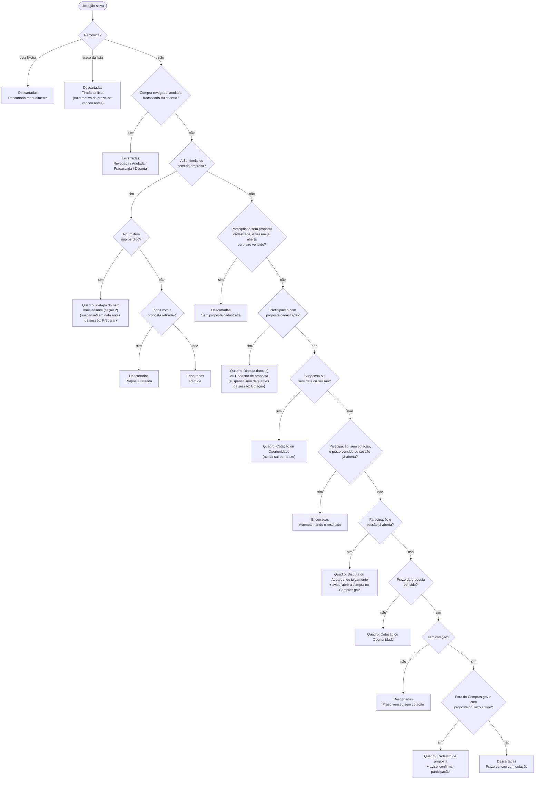

# Torre de Controle — como funciona

A Torre é a **tela inicial** do Licita (desde 08/11/2026). Ela acompanha cada
licitação da oportunidade até o dinheiro na conta. Este documento explica a
lógica inteira: o que é cada etapa, de onde vem cada informação e em que
arquivo está cada regra.

> **Regra de ouro:** a etapa é **calculada**, nunca gravada. Ninguém escolhe
> etapa num select nem arrasta cartão. A etapa muda quando um **fato** muda
> (uma cotação salva, uma leitura da Sentinela, um empenho no Portal da
> Transparência, uma entrega lançada). Para mudar onde um cartão aparece,
> mude o fato — ou a regra em `torre.py`, com teste.

## 1. Estágios e etapas

São **4 estágios** e **16 etapas**, nesta ordem (a ordem importa: a etapa
"mais adiante" ganha).

| Estágio | Etapa (`chave`) | Quando a licitação está nela | De onde vem o fato |
|---|---|---|---|
| Preparar | Oportunidade (`oportunidade`) | salva no Licita, no prazo, sem cotação. Também a suspensa ou sem data antes da sessão, sem preço (GEN-72) | Licita (busca) |
| Preparar | Cotação (`cotacao`) | tem cotação salva no Cotador, no prazo. Também a suspensa ou sem data antes da sessão com preço só no Compras.gov (GEN-72). O PDF da proposta não muda a etapa | Licita (Cotador) |
| Preparar | Cadastro de proposta (`cadastro_proposta`) | aceita/cadastrada no Compras.gov, **ainda sem preço lançado** no item | Sentinela |
| Disputar | Aguardando sessão (`aguardando_sessao`) | **preço lançado** no Compras.gov e a sessão ainda não abriu (10/11/2026). Etiqueta com a data da sessão; sem cotação no Licita, avança assim mesmo com o aviso "sem cotação no Licita" | Sentinela |
| Disputar | Disputa (`disputa`) | sessão aberta: análise das propostas (`AP`) e lances. Compra em análise (`2`), em disputa (`3`) ou em seleção de fornecedores (`4`) sem itens lidos também (14/11/2026) | Sentinela |
| Disputar | Aguardando julgamento (`aguardando_julgamento`) | disputa encerrada (`E`), proposta ainda sem situação | Sentinela |
| Disputar | Propostas aceitas (`propostas_aceitas`) | proposta **aceita** (situação `3`), ainda não habilitada (14/11/2026) | Sentinela |
| Disputar | Habilitada (aguardando adjudicação) (`aguardando_adjudicacao`) | fornecedor **habilitado** (`4`), sem recurso aberto | Sentinela |
| Disputar | Recursos (`recursos`) | item em recurso, contrarrazões ou decisão (`AR`, `AC`, `D1`, `D2`), ou habilitado com prazo de recurso aberto. Etiqueta vermelha com o prazo (14/11/2026) | Sentinela |
| Disputar | Finalizadas (`finalizadas`) | **adjudicado** (`AE` ou proposta `6`): falta só a homologação. Pelo art. 71 da Lei 14.133, a adjudicação vem depois dos recursos (14/11/2026) | Sentinela |
| Contratar | Homologado (`homologado`) | resultado **homologado** (PNCP ou Sentinela). Abre o estágio Contratar: ganhou, agora é esperar contrato ou empenho (pedido do Carlinhos, 08/11/2026) | Sentinela + PNCP (dias úteis) |
| Contratar | Contrato (`contrato`) | contrato ou **ata** de registro de preços | PNCP (ata, diário) · contrato à mão |
| Contratar | Empenho / OF (`empenho`) | empenho ou ordem de fornecimento | Portal da Transparência (federal, diário) · OF e estados/prefeituras à mão |
| Receber | Entrega (`entrega`) | entrega lançada | à mão |
| Receber | Liquidado (`liquidado`) | liquidação | Portal da Transparência (federal) |
| Receber | Recebido (`recebido`) | pagamento | Portal da Transparência (federal) |

```mermaid
flowchart LR
    subgraph preparar["Preparar"]
        oportunidade["Oportunidade"] --> cotacao["Cotação"] --> cadastro["Cadastro de proposta"]
    end
    subgraph disputar["Disputar"]
        aguardando["Aguardando sessão"] --> disputa["Disputa"] --> julgamento["Aguardando julgamento"] --> aceitas["Propostas aceitas"] --> adjudicacao["Habilitada (aguardando adjudicação)"] --> recursos["Recursos"] --> finalizadas["Finalizadas"]
    end
    subgraph contratar["Contratar"]
        homologado["Homologado"] --> contrato["Contrato"] --> empenho["Empenho / OF"]
    end
    subgraph receber["Receber"]
        entrega["Entrega"] --> liquidado["Liquidado"] --> recebido["Recebido"]
    end
    cadastro --> aguardando
    finalizadas --> homologado
    empenho --> entrega
```

A seta mostra a **ordem** (`torre.ESTAGIOS`), não um caminho obrigatório: a
etapa é calculada a cada vez, e uma licitação pode pular etapas.

Coisas que **não** são etapa:

- **O PDF da proposta** (proposta comercial/ajustada). Ele é pedido **depois
  de ganhar**, durante o julgamento (convocação de anexo). Gerar o PDF não
  muda a etapa. Fica no menu em "Propostas (PDF)".
- **Recurso** de outra empresa num item em que a Inside não está na fase de
  recurso: é etiqueta ("recurso de X · contrarrazões até…"). O item em
  recurso tem a etapa **Recursos** (14/11/2026).
- **Suspensa** — é etiqueta. A licitação continua onde estava, **exceto antes
  da sessão** (regra abaixo, GEN-72).

## 2. A etapa é do item

Uma licitação tem vários itens, e a empresa disputa alguns. **Cada item da
empresa tem a sua etapa.** O cartão da licitação fica na etapa do item que
está **mais adiante**.

A função que decide a etapa de um item é `etapa_do_item` em
`backend/apps/licitacoes/torre.py`. Ela olha do fato mais adiantado para
trás e para no primeiro que encontra:

1. Item **perdido** → não conta (sai da conta do cartão):
   homologado para outro fornecedor, proposta desclassificada (situação
   1, 2 ou 9), fornecedor inabilitado (5) ou **1º já habilitado** (outra
   empresa à frente já foi aceita/habilitada; 09/11/2026) ou **julgamento /
   habilitação encerrados sem a Inside** (fase `JE`/`HE` sem proposta
   aceita, habilitada ou adjudicada; 14/11/2026). Exceção: convocação,
   pedido de desconto, **diligência** ou recurso em aberto traz o item de
   volta. O item em `JE` sem a Inside é lido **a cada ronda** (10 min), não
   só na vigia diária: o 2º colocado pode ser convocado com prazo de horas.
2. Tem **pagamento** → Recebido.
3. Tem **liquidação** → Liquidado.
4. Tem **entrega** → Entrega.
5. Tem **empenho** ou **ordem de fornecimento** → Empenho / OF.
6. Tem **contrato** ou **ata** → Contrato.
7. **Vencedor homologado** (PNCP ou Sentinela) → Homologado. Pela Sentinela,
   desde 14/11/2026 (GEN-89), basta a **proposta da empresa** vir com
   `homologado: true` e situação adjudicada (6); antes só pelas propostas de
   todos (ver `SENTINELA.md`).
8. Adjudicado (situação 6, fase `AE`) → Finalizadas.
9. Em recurso (`AR`, `AC`, `D1`, `D2`) ou habilitado com prazo de recurso
   aberto → Recursos (com etiqueta).
10. Fornecedor habilitado (4) → Habilitada (aguardando adjudicação).
11. Proposta aceita (3) → Propostas aceitas.
12. Abertura suspensa (`LS`) → Aguardando sessão.
13. Análise das propostas (`AP`) ou lances → Disputa.
14. Fase depois da disputa (`E`, `PE`, `PR`, `JR`), ou já tem classificação
    → Aguardando julgamento.
15. Preço lançado (`valor_proposta_inicial`) → Aguardando sessão.
16. Senão → Cadastro de proposta.

Um item em **2º lugar ou pior** fica marcado como `perdendo` (em cinza no
cartão: "2 itens perdendo (podem ser chamados)"). Ele **não** é perdido: o
1º colocado pode ser desclassificado e o próximo é chamado.

Documentos financeiros e entregas **sem item** valem para a compra inteira
(um contrato que cobre todos os itens ganhos).

Se **todos** os itens da empresa se perderam, a licitação sai para
**Encerradas** (motivo "Perdida").

### Licitação sem dado do Compras.gov (só Preparar)

Antes da Sentinela ler alguma coisa, a etapa vem do que o Licita sabe:

- sem cotação → Oportunidade; com cotação → Cotação;
- **prazo vencido com cotação, no Compras.gov.br, sem nenhuma participação
  lida pela Sentinela** → Descartadas ("Prazo venceu com cotação") já no dia
  seguinte ao prazo (decisão de 10/11/2026, Guarulhos 461/2026). Antes ficava
  em Cadastro de proposta "confirmar com a Sentinela" e, sem proposta, a
  confirmação nunca chegava. Descartadas é calculado: se a Sentinela achar a
  participação depois, a compra volta sozinha;
- prazo vencido com cotação em **outro portal** → Descartadas, a não ser que
  tenha proposta gerada no fluxo antigo (aí fica em Cadastro de proposta com
  "confirmar participação").

## 3. Saídas do quadro: Encerradas e Descartadas

Regra da operação (07/11/2026): **cotar não é participar.**

| Vai para | Quando | Motivo exibido |
|---|---|---|
| **Encerradas** (participou) | todos os itens da empresa perdidos | Perdida |
| Encerradas | compra revogada, anulada, fracassada ou deserta (situação da compra no Compras.gov) | Revogada / Anulada / Fracassada / Deserta |
| **Descartadas** (não participou) | tirada da lista antes do prazo | Tirada da lista |
| Descartadas | prazo venceu sem cotação | Prazo venceu sem cotação |
| Descartadas | prazo venceu com cotação, fora do Compras.gov.br — ou no Compras.gov.br **sem nenhuma participação** lida pela Sentinela (desde 10/11/2026) | Prazo venceu com cotação |
| Descartadas | apareceu nas participações do Compras.gov **sem proposta cadastrada** (a lista "meus itens" vem vazia) | Sem proposta cadastrada |
| Descartadas | tinha preço lançado e **retirou a proposta** de todos os itens (o Compras.gov diz que a empresa não participa mais, "meus itens" vem vazio, ou o item volta sem a proposta dela) | Proposta retirada |

**Proposta retirada (12/11/2026, GEN-71).** Caso real: Dispensa 27/2026
(Cabedelo). A sessão passou, ele retirou a proposta e não participou, e a
compra ficou em "Aguardando sessão" para sempre. Três motivos: (1) a leitura
"não é mais participante" era ignorada inteira; (2) os itens com preço
continuavam gravados; (3) a ronda só relia compras na fase 3 ou 4. Agora:

- o item ganha `retirada_em` e sai do quadro ("proposta retirada"). Se a
  proposta for lida de novo com preço, a marca some;
- **todos** os itens retirados → **Descartadas · Proposta retirada**
  (decisão da operação: não foi ao certame). Retirou uns e perdeu outros →
  Encerradas · Perdida;
- a ronda também relê as compras ainda gravadas **antes da sessão** cuja
  sessão (ou, sem data, o prazo) já passou (ver `SENTINELA.md`).
- **A confirmar:** a resposta real do Compras.gov para proposta retirada
  (não há exemplo gravado). A regra usa o que já se sabe: um item em que a
  empresa não tem proposta volta **sem** o bloco `propostaItem` (59/2026,
  item 1, HAR de 08/11/2026).

- **Uma licitação está em um lugar só:** no quadro, em Encerradas ou em
  Descartadas. `test_saidas.py` garante isso.
- A regra de saída mora **num lugar só**: `torre.avaliar` (desde
  09/11/2026). As listas de Encerradas e Descartadas e os números do menu
  saem dela (`encerradas.classificar`). Ao mudar, rode `test_saidas.py`.
- Nada é apagado. "Tirar da lista" é remoção lógica.

### Como a Torre decide (diagrama)

Desenhado a partir de `torre.avaliar` e `encerradas.classificar`, na ordem do
código (11/11/2026; proposta retirada em 12/11/2026). A primeira pergunta com "sim" decide.

**"Acompanhando o resultado"** existe no código (Encerradas), mas a tabela
acima ainda não o mostra: onde ele deve ficar e com que data está **a
confirmar** (GEN-56).

## 4. Registro de preços (ata)

Em registro de preços (ex.: 201/2026 UFVJM, 61/2026 IF Farroupilha) não há
contrato: há **ata**. O órgão empenha **quando precisa**, em partes, até a
ata vencer. Um item pode ter **vários empenhos**. O valor homologado é o
**teto**, não venda garantida. A sincronia do PNCP guarda a vigência e a
quantidade já empenhada da ata em `DocumentoFinanceiro.dados`.

## 5. Etiquetas e urgência

O cartão pode ter etiquetas, em 3 níveis: **alerta** (vermelho, ex.:
"proposta até amanhã", convocação), **aviso** (amarelo, ex.: "fora dos favoritos no
Compras.gov", "sem cotação no Licita") e **info** (ex.: "sessão 13/11 09:00"). A borda do cartão acende com a cor
da mais grave. **A cor nunca é a única pista:** o texto da etiqueta diz o
porquê.

Ordem dos cartões em cada estágio (`_urgencia`): alerta primeiro, depois
aviso, depois o prazo mais curto.

## 5b. Lixeira e recurso (08/11/2026)

**Lixeira** (`apps/licitacoes/lixeira.py`, `POST salvas/<id>/descartar/`):

- Em **todo cartão de Preparar e de Disputar**. Para o Carlinhos é uma coisa
  só: um clique, uma pergunta, e vai para **Descartadas**.
- A pergunta mostra o **preço lançado** quando a Sentinela já leu os itens
  ("Você tem preço cadastrado no item 2 (Dellamed D600, R$ 1.200,00, 23º
  lugar). Deseja prosseguir?"), ou avisa que ainda não conferiu. Nunca bloqueia.
- O motivo grava **quem, quando, em que etapa e com que preço** ("Descartada
  manualmente por Carlinhos em 09/11/2026, na etapa Aguardando julgamento.
  Tinha preço no item 2 (…)") — Descartadas e "Ver processo" mostram esse
  texto. Motivo `descartada_manual`, que vale sobre as outras regras.
- **Descartadas passa a aceitar quem participou** quando é ele que descarta
  (decisão de 08/11). As saídas automáticas continuam em Encerradas.
- No Compras.gov, a Sentinela **tira o favorito** (tarefa
  `sentinela.Tarefa`). Com preço lançado a compra continua em "Minhas
  participações" — lá fica "poluído", o Licita fica limpo.
- **A Sentinela nunca traz de volta** o que foi descartado: atualiza os fatos
  em silêncio. **Exceto convocação** (anexo pedido ou chamada de
  remanescente): a licitação volta para a Torre, em vermelho, com o evento
  "Voltou para a Torre sozinha: …".

**Vermelho = pede resposta da empresa:** convocação (anexo, remanescente),
pedido de desconto, **recurso**, diligência.

**Recurso** (`fase-recursal-fornecedor/<sessão>`, lido pela ronda da
Sentinela, sem captcha). Caso real: Pregão 56/2026, item 22 — a Brava Sul
recorreu em 05/10, o prazo de contrarrazões venceu em 09/10 sem resposta, o
recurso foi indeferido em 13/10 e mantido em 26/10. O cartão mostra:

| Situação | Etiqueta |
|---|---|
| recurso cadastrado, prazo de contrarrazões aberto | 🔴 "recurso de Brava Sul · item 22 · contrarrazões até 09/10 23:59" |
| prazo passou, sem decisão | 🔴 "recurso de … · item 22 · aguardando decisão" |
| procedente / revertido (P, R) | 🔴 "recurso procedente · item 22" |
| indeferido / mantido (N, M) | "recurso indeferido · item 22" (informação) |

## 6. Os dados (models)

Todos em `backend/apps/licitacoes/models.py`. Foram **acrescentados** ao lado
do que existia (nenhuma migração apagou nada).

| Model | O que guarda | Quem preenche |
|---|---|---|
| `OportunidadeSalva` | a licitação (já existia); ganhou `numero_processo` | busca do Licita, ou a sincronia do PNCP (cria a salva de uma vitória que não estava no Licita) |
| `ParticipacaoCompra` (1 por salva) | o que o Compras.gov diz da compra: fase, situação (PD/SU/RE/AN/FR/DE), se tem proposta cadastrada, diligência/convocação em andamento, quando a sessão abre, fonte | Sentinela |
| `ItemParticipado` (N por salva) | cada item da empresa: número, descrição, quantidade, marca/modelo, classificação, situação da proposta, fase do item, valores (inicial, lance, negociado, homologado), recurso, `vencedor_e_a_empresa` | Sentinela · PNCP (vitórias) |
| `DocumentoFinanceiro` (N por salva, opcional por item) | contrato, ata, empenho, ordem de fornecimento, liquidação, pagamento: número, data, valor, fonte, dados brutos. Pode ficar **sem licitação** até alguém ligar | PNCP (ata) · Portal da Transparência · à mão |
| `Entrega` (N por salva) | data, nota fiscal, observação | à mão |

Códigos do Compras.gov (fase da compra, fase do item, situação da proposta)
estão como constantes no topo de `torre.py`. A fonte é a lista pública
`comprasnet-fase-externa/v1/enums`.

## 7. Sincronias diárias (sozinhas)

Rodam no Celery Beat, no horário de Brasília, **de segunda a sexta** (fim
de semana não tem movimentação). Agendadas por migração (`0007`, `0009` e
`0010`, que passou para dias úteis), então já nascem ligadas em qualquer servidor.

| Hora | O quê | Arquivo | Rodar à mão |
|---|---|---|---|
| 8h | **PNCP**: itens homologados para os CNPJs ativos em Cadastros › Empresas e itens de ata. Cria a salva se a vitória não estava no Licita | `sincronia_pncp.py` | `manage.py sincronizar_pncp` |
| 8h10 | **Portal da Transparência**: empenho, liquidação e pagamento (federal), ano atual e anterior. Liga à licitação pelo **número do processo** (também quando vem na observação): iguais pelos dígitos **ou** pedaço a pedaço sem os zeros à esquerda (`00054-00061297/2026-38` = `054-00061297/2026-38`). Sem processo, pela **UG = UASG** quando há uma única licitação ganha naquela unidade. **Avisa no sino e no Telegram** cada documento novo: ligado ou "sem licitação" | `sincronia_transparencia.py` | `manage.py sincronizar_transparencia` |

- As duas são **idempotentes**: rodar de novo atualiza, não duplica.
- Uma ligação feita à mão nunca é desfeita pela sincronia.
- A API de Dados Abertos aceita no máximo **365 dias por consulta**; o
  cliente (`integracoes/clients/compras_gov.py`, `_paginar_por_periodo`)
  divide sozinho.
- O Portal precisa da chave `PORTAL_TRANSPARENCIA_CHAVE` no `.env` do
  servidor (passo a passo em `deploy/ec2/README.md`). Sem a chave, a
  sincronia só avisa no log e não roda.
- **Estados e prefeituras** não estão no Portal da Transparência federal:
  para eles empenho, liquidação e pagamento são lançados à mão.
  **Exceção: PMDF, PCDF e CBMDF estão lá.** Quem paga é o **Fundo
  Constitucional do DF** (federal, roda no SIAFI), com UG própria (ex.:
  170485), diferente da UASG da compra (ex.: 926670). A UG nunca bate; quem
  liga é o número do processo.

### Número do processo e órgão pagador (GEN-97, 18/11/2026)

Caso real: **PMDF, Pregão 56/2026**. O empenho chegou por e-mail; o Licita já
o tinha desde 16/11, mas ficou "sem licitação" e ninguém viu.

- **Processo não tem tamanho fixo** (não é como o CNPJ): cada órgão e cada
  sistema tem o seu formato, e o SIAFI corta zeros à esquerda que o PNCP
  mantém. O PNCP trouxe `00054-00061297/2026-38`; o Portal,
  `054-00061297/2026-38`. Regra: iguais pelos dígitos **ou**, com símbolos
  (`-` `/` `.`) nos dois, pedaço a pedaço sem os zeros à esquerda. Um dígito
  diferente não liga.
- **Aviso** (decisão da operação): documento novo que **ligou** → aviso
  "Empenho · Pregão 56/2026" (informação), com valor e órgão pagador.
  **Não ligou** → aviso "Empenho sem licitação · 2026NE…" (aviso), com o
  processo, para ligar à mão. Um "sem licitação" que depois liga sozinho
  avisa de novo; ligado à mão, não. Vale para empenho, liquidação e
  pagamento. Tipo `financeiro` no sino, em "Para saber"; desde 19/11/2026
  (GEN-104) não vai mais ao Telegram.
- **Órgão pagador**: campo `orgao_pagador` nos documentos financeiros da API
  ("UG (UG código) · órgão"), lido dos dados do Portal. Lançado à mão: vazio.
- **Contratos no PNCP** ainda não são lidos: o módulo de contratos da API
  estava instável (Comunicado nº 18/26) e não havia contrato real para
  conferir o formato. Contrato é lançado à mão.

## 8. API

Todas em `/api/licitacoes/`, exigem login.

| Rota | O quê |
|---|---|
| `GET torre/` | o quadro inteiro: estágios, etapas com totais, cartões já ordenados, e quantas saíram (encerradas/descartadas) |
| `GET/POST salvas/<id>/documentos-financeiros/` | lista / lança à mão (contrato, OF, empenho de estado ou prefeitura…) |
| `GET/POST salvas/<id>/entregas/` | lista / lança entrega |
| `DELETE documentos-financeiros/<id>/`, `DELETE entregas/<id>/` | apaga — **só o que é manual**; o que veio de sincronia não se apaga |
| `GET documentos-financeiros/sem-licitacao/` | o que o Portal trouxe e não deu para ligar (cada documento traz `orgao_pagador`) |
| `POST documentos-financeiros/<id>/ligar/` | liga a uma licitação (e item, opcional) |
| `GET encerradas/`, `GET descartadas/` | as listas de saída, com filtros |
| `GET/POST salvas/<id>/descartar/` | a lixeira: a pergunta (preço lançado) / descartar |

O cartão (`montar_torre` → `_cartao`) já vem pronto para a tela: etapa,
rótulo, `compra` ("Pregão 112/2026", tirado do código da compra no link do
Compras.gov: UASG + modalidade + número + ano), itens com valores,
`valor_ganho`, etiquetas. Em Preparar também vem a salva inteira e o
`cotacao_id`, para abrir os modais que já existem.

## 9. As telas

Frontend em `frontend/src/app/pages/torre/`.

| Rota | Tela | Arquivo |
|---|---|---|
| `/torre` | **tela inicial**: os 4 estágios lado a lado, cartões por urgência | `torre.page.*` |
| `/torre/estagio/<estagio>` | um estágio aberto (como o artboard "v2 · Estágio Disputar aberto"): as etapas lado a lado numa linha só, sem borda em volta, e os outros estágios recolhidos em faixas encostadas no menu (os de antes) e no fim da janela (os de depois) | `estagio/` |
| `/torre/etapa/<etapa>` | a lista de uma etapa (tabela) | `etapa/` |

- **Cartão** (`torre-cartao/`): pílula com a etapa, UASG, órgão, compra e
  item ("Pregão 61/2026 · item 22"), posição e conta ("1º lugar · 20 ×
  R$ 11.999,00 = R$ 239.980,00"), trilha das próximas etapas, etiquetas.
  As frases são montadas em `torre.utils.ts` (testadas em
  `torre.utils.spec.ts`).
- **Clique no cartão** (`torre-acoes.service.ts`): em Preparar abre o modal
  da oportunidade ou o Cotador; nos outros estágios (Disputar, Contratar,
  Receber) abre o modal **Processo** do Licita (onde está, onde parou, linha
  do tempo). Lá dentro: "Ver cotação" (abre o Cotador) e o link do
  Compras.gov, que abre pela Sentinela numa cópia da aba já logada.
  **Por quê (11/11/2026, GEN-53/64):** o cartão abria o Compras.gov direto;
  sem a aba logada a página era inválida. Por isso `GET torre/` agora manda
  `salva` (o registro inteiro) e `valor_cotado` em **todos** os cartões, não
  só em Preparar.
- **Oportunidade e Cotação** no menu abrem as listas que já existiam
  (Salvas e Cotador), não uma lista nova. **Desde 14/11/2026 (GEN-87) as
  duas listas são exatamente Torre › Oportunidade e Torre › Cotação**
  (`torre.ids_na_etapa`). **Por quê:** o Carlinhos via 4 em Preparar e 13
  em Oportunidades. Cada tela tinha o seu filtro (cotação sim/não + prazo):
  as compras que ele só acompanha, trazidas pela Sentinela sem prazo,
  seguiam em Oportunidades; e a suspensa com preço só no Compras.gov não
  aparecia no Cotador. Agora o Cotador mostra essa linha com o selo "Sem
  cotação no Licita"; o único botão é "Abrir cotação", que cria a cotação.
  Teste: `test_telas_torre.py`.
- **Menu** (`layout/sidebar/`): azul escuro, Buscar em destaque, os 4
  estágios sempre abertos, e o **número de licitações em cada etapa**
  (`contagem-do-menu.service.ts` relê `GET torre/` a cada troca de tela).
- **Topo** (`layout/topo-status/`): empresa e CNPJ, **Radar** (quantas sugestões há; abre `/radar`, GEN-68),
  **Sentinela** (verde lendo, âmbar precisa de você, vermelho parada) e
  **sino**. Mostram o estado verdadeiro.
- **Visual:** segue o protótipo "Licita v1.0"
  (https://claude.ai/artifact/ET6ZEAExDHZRCfk5rNPyac, artboards "v2"). Cores
  em `frontend/src/styles/_tokens.scss` (`--color-menu-*`, `--color-coluna*`,
  `--color-etapa-*`); letra Plus Jakarta Sans.

## 10. Testes

| O quê | Onde |
|---|---|
| Regra de cada etapa, com os casos reais (61, 56, 112, 201, 55) | `backend/apps/licitacoes/test_torre.py` |
| Uma licitação em um lugar só (quadro × Encerradas × Descartadas) | `test_saidas.py` |
| Lançamentos manuais | `test_lancamentos.py` |
| Sincronias (formato real das APIs, sem rede) | `test_sincronia_pncp.py`, `test_sincronia_transparencia.py` |
| Clients | `apps/integracoes/test_compras_gov.py`, `test_transparencia.py` |
| Telas | `*.spec.ts` ao lado de cada arquivo em `pages/torre/` e `layout/` |

Para mudar uma regra: escreva o teste com o caso real primeiro, veja falhar,
mude `torre.py` (a saída também mora lá), rode tudo.

## 10b. Códigos oficiais e decisões pendentes (14/11/2026)

Cada código de fase e situação do Compras.gov.br e do PNCP, a etapa da Torre
em que ele cai e o nome na tela, estão em
[Status oficiais × Licita](STATUS_OFICIAIS.md). O levantamento achou **8
pontos a decidir** (D1 a D8), por exemplo item cancelado/deserto/fracassado
que fica preso na Torre e diligência cancelada contada como aberta. Nada foi
mudado no código naquele dia; todos ficaram **a confirmar** pela operação.
A D2 foi decidida e feita em 18/11/2026 (GEN-76): só a diligência `A`
(em andamento) conta como aberta.

Em 14/11/2026 o Carlinhos decidiu 16 mudanças na Torre: 3 fases novas em
Disputar (Propostas aceitas, Finalizadas, Recursos), para onde vai cada fase
oficial, nomes iguais aos do Compras.gov.br, card com linha do tempo à parte
e avisos no Telegram. Estão em
[Status oficiais × Licita, seção 5](STATUS_OFICIAIS.md#5-decisoes-do-carlinhos-14112026),
cada uma com o seu cartão GEN. **Ainda não foram feitas no código**: as
etapas descritas acima continuam valendo até cada PR mudar.

## 11. O que ainda não existe

Em ordem de prioridade (combinado com a operação):

A Sentinela (0.2.4) e os avisos no Telegram **já existem** (ver
[`SENTINELA.md`](SENTINELA.md)). Falta:

1. ~~Fim da vigia por contrato~~ — **feito em 18/11/2026 (GEN-46)** pelo
   Contratos.gov.br, para os órgãos que o usam. Falta o PNCP e o Portal da
   Transparência para os outros órgãos (cartão novo).
2. **Telegram para cobrança.** Empenho, liquidação e pagamento do Portal da
   Transparência **já avisam** no sino (GEN-97, 18/11/2026). Desde o GEN-104
   (19/11/2026) ficam em "Para saber" e **não vão ao Telegram**; voltar a
   mandar ao Telegram é o GEN-105 (a decidir).
3. **Telas de lançamento manual** — a API existe (contrato, OF, entrega,
   ligar documento "sem licitação"); falta o formulário na tela. Inclui
   mostrar o **órgão pagador** de cada documento (**GEN-98**).
4. **Prazo de validade da proposta** (Lei 14.133, art. 90, §3º) e lembrete
   de cobrança por dias parados.
5. **Contratos pelo PNCP**, quando o módulo estabilizar e houver um contrato
   real para conferir.

O plano detalhado, com caixas de seleção, está em
[`Tarefas/feat-torre-de-controle.md`](Tarefas/feat-torre-de-controle.md).

## Radar (14/11/2026, GEN-68)

**Por quê:** o Carlinhos salva dezenas de oportunidades por mês, de itens
que se repetem. O Radar faz essa busca por ele.

| Regra | Como é | De onde veio |
|---|---|---|
| Base do "parecido" | itens das oportunidades **salvas nos últimos 30 dias** (tiradas da lista não contam) + itens que a Inside **ganhou** (qualquer data). O que foi só digitado na busca não conta: o Licita não guarda o histórico da busca | cartão GEN-68 + operação, 14/11 |
| "Parecido" | a descrição do item vira o termo da busca textual do PNCP pelo **tipo do catálogo** (PDM, como em `mercado.achar_pdm`); sem PDM, as 4 primeiras palavras. Ganho vem primeiro; até 30 termos por rodada (o PNCP limita por IP) | decisão técnica |
| Onde | **todos os portais** (o PNCP agrega todos) e o **Brasil todo**; a tela tem filtro de UF | cartão + operação |
| Quando | todo dia, **8h e 18h** (`licitacoes.radar`, migration `0023_agenda_radar`) | cartão |
| O quê | compras **recebendo proposta**, publicadas de anteontem para cá, que não estão salvas no Licita (nem tiradas da lista) | cartão |
| Quanto tempo | **7 dias ou até a abertura da disputa**, o que vier primeiro. No dia da abertura ainda aparece (a proposta vai até a hora da sessão; o Licita só guarda o dia) | cartão + ajuste da operação, 14/11 |
| Aviso | só o **número no botão Radar** do topo (sem sino, sem Telegram) | operação |
| Tela | `/radar`: as colunas de Salvas + "Parecida com". O clique abre o **mesmo card da busca**; "Salvar oportunidade" leva para Oportunidades e tira do Radar | cartão |

Código: `apps/licitacoes/radar.py`, `SugestaoRadar`, `GET licitacoes/radar/`
(`uf`, `busca`, `ordering`) e `GET licitacoes/radar/total/`. A busca textual
aceita `plataforma=None` (todas) só para o Radar; a busca da tela continua
no Compras.gov. Testes: `test_radar.py`.

**Limite do PNCP (rodadas reais de 14/11/2026, 4 termos):**

| Versão | Achadas | Perdidas (429) | Tempo |
|---|---|---|---|
| como a busca da tela (detalhe de cada compra, 20 por vez) | 24 | ~30 | 4 min |
| + espera no 429, 3 por vez | 39 | 30 | 8 min |
| **sem o detalhe** (versão no ar) | **58** | **0** | **44 s** |

O detalhe (`/api/consulta/`) é o endpoint com limite por IP; a busca da
tela precisa dele para filtrar o portal, o Radar não. O portal e o link
aparecem quando o card é aberto (o card pede o detalhe). O Radar ainda
espera e tenta de novo no 429 (`PncpPaciente`), faz 3 pedidos por vez e
pausa 2 s entre termos.

**Teste no servidor (ambiente de teste, 15/11/2026):** 8 termos → 67
compras novas, 0 falhas; regra "7 dias ou abertura" conferida. Dois achados,
corrigidos no mesmo PR:

1. **Itens:** o serviço de itens do PNCP (`/api/pncp/v1`) estava fora do ar
   para todos (503 daqui e do servidor) — as 67 entraram sem itens. Agora
   cada rodada tenta de novo os itens das sugestões que ficaram sem; e o
   "completar pelo PNCP" trata o item vazio (sem descrição) como "sem itens"
   — antes, a compra salva assim parecia completa.
2. **Termo fraco:** sem tipo no catálogo, o termo eram as 4 primeiras
   palavras ("tonometro modelo goldman tipo"), e "tipo", "serviço"
   puxavam compras sem relação. Agora é o nome do item: o que vem antes do
   primeiro ":" sem a última palavra (padrão do catálogo `<nome> <atributo>:
   <valor>`) — "Tonômetro".

**Só entra compra com item que casa (regra da operação, 17/11/2026).** Teste
real com o PNCP de volta: 69 sugestões, mas só 23 tinham um item com todas
as palavras do termo ("lâmpada fenda" trazia abraçadeira e alicate: a busca
do PNCP acha as palavras separadas, no objeto). Agora:

1. O Radar lê **todos** os itens da compra (página por página, até 500),
   não só os 50 primeiros.
2. Entra só se **1 item** tem **todas** as palavras do termo (sem "de",
   "para"…; plural conta). Os itens que casam vêm primeiro no card.
3. Sem itens (PNCP fora), a compra fica **pendente**: não aparece, e a
   rodada seguinte decide.

Resultado no mesmo teste: **42 sugestões, todas com relação**; 30
descartadas; 67 s.

**Remover do Radar (GEN-93, 17/11/2026).** Uma **lixeira** em cada linha
(pedido da operação: lixeira, não menu; clicar na linha abre o card), sem
confirmação: a compra sai da lista e do número do botão e
**não volta** (nem depois dos 7 dias: a remoção fica guardada). Por quê: a
lista fica limpa, e a remoção vira exemplo do que ele **não** quer para a IA
do Radar (GEN-93, ainda não ligada). API: `POST licitacoes/radar/<id>/remover/`.

**Rodar na mão:** `python manage.py radar` roda uma rodada agora e mostra a
base, o resumo e, de cada sugestão nova, quantos itens vieram do PNCP. Serve
para o ambiente de teste (que não tem o agendamento) e para produção.

## Regras de 09/11/2026 (vigia, datas, acompanhadas e o sino)

A regra de "onde está cada licitação" mora **num lugar só**: `torre.avaliar`.
As listas de Encerradas e Descartadas e os números do menu saem dela
(`encerradas.classificar`) — antes havia uma cópia da regra em forma de
consulta, e o menu dizia 3 descartadas enquanto a lista mostrava 4.

| Caso | Onde fica | Aviso |
|---|---|---|
| Compra **suspensa** (Compras.gov `SU` ou PNCP), **antes da sessão** | Preparar: **Cotação** se há cotação no Licita **ou** preço lançado no Compras.gov; senão **Oportunidade** | "Compra suspensa" (+ "preço lançado no Compras.gov, sem cotação no Licita") |
| Disputa agendada **sem data** que o **Compras.gov disse** (fase 99 sem data de abertura), prazo vencido, antes da sessão | a mesma regra | "Sem prazo definido" (+ a do preço) |
| Compra suspensa **depois** que a disputa começou | na etapa do item (Disputa, Julgamento, Recursos…) | "Compra suspensa" |

**Regra da suspensa antes da sessão (14/11/2026, GEN-72).** Caso real: Pregão
9/2026 do Butantan, "Disputa agendada · Sem prazo definido" no Compras.gov,
preço lançado (R$ 170,00 nos itens 1 e 2) e sem cotação no Licita. Aparecia em
Disputar › Aguardando sessão. Decisões da operação:
- a suspensa (e a sem data) segue a lógica da suspensa: fica em **Preparar**
  esperando a data nova. **Cotação** se há cotação no Licita **ou** no
  Compras.gov (preço lançado); se não há em nenhum dos dois, **Oportunidade**;
- vale **só antes da sessão** (itens em Cadastro de proposta ou Aguardando
  sessão). A lei e o Compras.gov permitem suspender depois da disputa
  (recurso, tribunal de contas, sessão suspensa pelo pregoeiro). Aí o cartão
  fica na etapa do item, para não esconder uma disputa viva;
- "sem data" só conta quando o **Compras.gov disse**: fase **99 (Disputa
  agendada)** sem data de abertura → `ParticipacaoCompra.sessao_sem_data`. Em
  "Minhas participações" o campo `dataHoraPrevisaoAbertura` **nem vem** nesse
  caso (exemplo real do Butantan; corrigido em 14/11/2026 — a 1ª versão
  esperava o campo vazio e não marcava). Data que a Sentinela só não leu, em
  outra fase, não tira a compra de Disputar;
- o cartão em Cotação sem cotação no Licita abre o visualizador da
  oportunidade (com "Iniciar cotação").
| Em "Minhas participações", prazo vencido, **sem cotação** | Encerradas · "Acompanhando o resultado" (relatório para "xeretar") | — |
| Item com o **1º já habilitado** (outra empresa) | item perdido; todos assim → Encerradas | 👎 "1º já habilitado" |
| Item perdido com **convocação**, pedido de desconto ou **recurso** pendente/procedente | volta para a Torre, de onde estiver | vermelho |

- **Sinais:** 👍 1º de verdade · 🟠 **só o próximo de verdade** (na frente dele
  sobrou só quem está sendo analisado; quem caiu não conta) · 👎 o resto.
- **Datas:** a Sentinela (compras favoritadas) e o PNCP (todas as de Preparar,
  1x por dia, servidor) atualizam o prazo; a mudança vira linha no histórico
  ("Data alterada pelo órgão: 10/11 → 17/11") e aviso no sino.
- **Vigia de quem perdeu:** todo item em que ele deu preço segue vigiado 1x por
  dia (proposta dele e recurso), esteja onde estiver, até a ata aparecer
  assinada com outra empresa (Dados Abertos, por UASG), até o item aparecer
  num **contrato, empenho ou termo de adesão** com outra empresa no
  Contratos.gov.br (GEN-46, 18/11/2026), ou 180 dias depois da homologação.
  Órgão que não usa o Contratos.gov.br (estados, municípios, ex.: PMDF): vale
  a ata ou o limite. Código: `licitacoes/conferencia_diaria.py`
  (`_encerrar_vigias`, `_encerrar_por_contrato`).
- **Acompanhadas:** os itens vêm do PNCP (`ItemAcompanhado`); as propostas, da
  Sentinela, 1x por dia. Se aparecer proposta da Inside, o item vira dela e a
  licitação volta para a Torre (rede de segurança).
- **O sino** (`apps/notificacoes`): convocação, pedido de desconto, recurso,
  data alterada, compra suspensa/revogada, fora dos favoritos, resultado de
  item perdido/acompanhado, relatório completo e, desde 18/11/2026 (GEN-97),
  empenho/liquidação/pagamento do Portal da Transparência. Uma notificação por fato
  (`chave`); cada pessoa marca as suas como lidas.
  - **Desde 19/11/2026 (GEN-104), em duas partes.** "Precisa de você"
    (`PRECISA_DE_VOCE` em `notificacoes/models.py`: mensagem, convocação,
    desconto, recurso, situação da compra, Sentinela parada) fica em cima,
    conta no número vermelho, faz o sino tremer e o título da aba piscar, vai
    ao Telegram e vira balão da Sentinela. O resto é "Para saber", recolhido.
    **Por quê:** 7 resultados da Dispensa 12/2026 de uma vez esconderam as
    mensagens do pregoeiro (18/11/2026).
  - **Resultado: um aviso por compra e por dia**, uma linha por item (antes,
    um por item).
  - **Resultado que já tinha saído** na primeira leitura de um item
    acompanhado é gravado **sem aviso** (é antigo).
  - **Compra "xeretar" que virou dele** (a rede de segurança achou a proposta
    da Inside): os outros itens **param de ser lidos** pela ronda; o que já
    foi lido continua no relatório.
  - **Fora dos favoritos: uma vez por compra** (antes avisava de novo se a
    compra voltasse aos favoritos e saísse outra vez).
- **Conferência diária** (Celery Beat, seg–sex 7h45): `conferencia_diaria.py`.

## Regras e relatórios de 10/11/2026

- **Cotou e não participou:** prazo vencido, com cotação, compra do
  Compras.gov **fora dos favoritos** (a Sentinela conferiu) → Descartadas
  ("Prazo venceu com cotação"), sem ficar em "confirmar com a Sentinela" para
  sempre (Geriatria 34/2026). Desde a Guarulhos 461 (mesmo dia), nos
  favoritos também: sem participação lida, vai para Descartadas.
- **Relatórios › Mês a mês** (`relatorio_mensal.py`): participou (mês do
  prazo), ganhou/perdeu (mês do resultado), faturamento, lucro (só com
  cotação: preço − custo da cotação). "Perdeu por pouco" = até 5%.
- **Mercado de cada item** (`mercado.py`): descrição do edital → PDM → item
  exato do catálogo (CATMAT, semelhança ≥ 0,98) → Pesquisa de Preços, 24
  meses. Média sem valores absurdos; marcas que mais venceram; quanto ele
  ofereceu. Renovado 1x por semana na conferência diária.
- **Caixa de mensagens e Telegram:** cada mensagem nova do Compras.gov e cada
  aviso do sino vão ao Telegram dos chats em `TELEGRAM_CHAT_IDS`. Desde
  19/11/2026 (GEN-104), só os de "Precisa de você".

